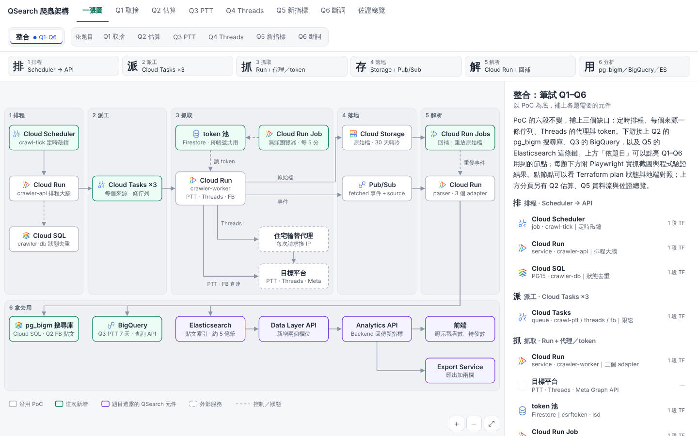
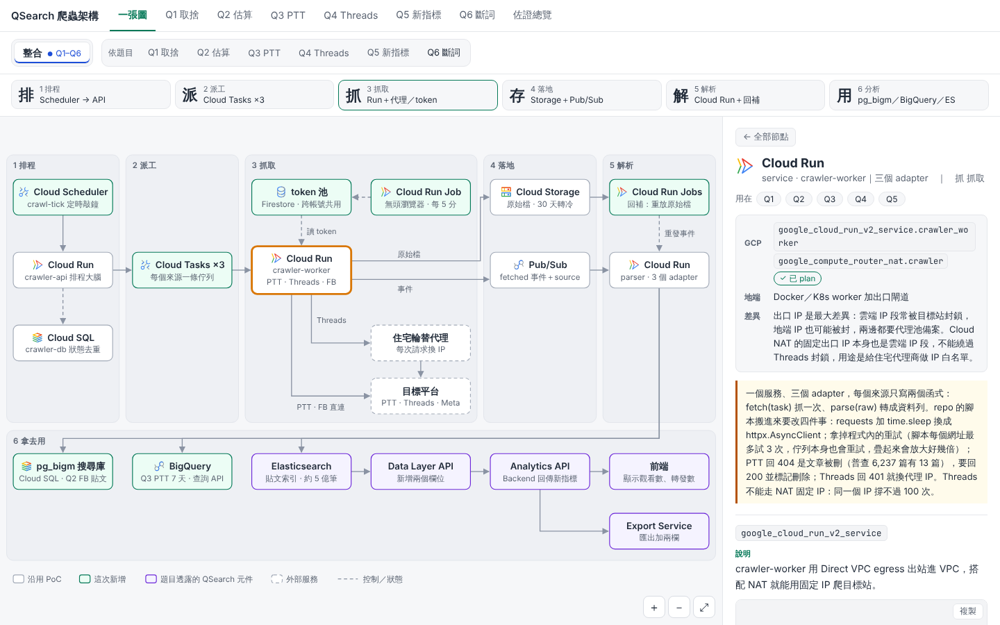
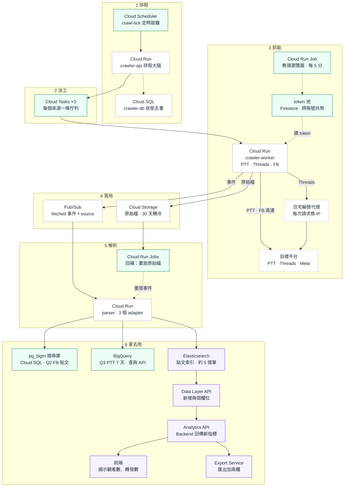
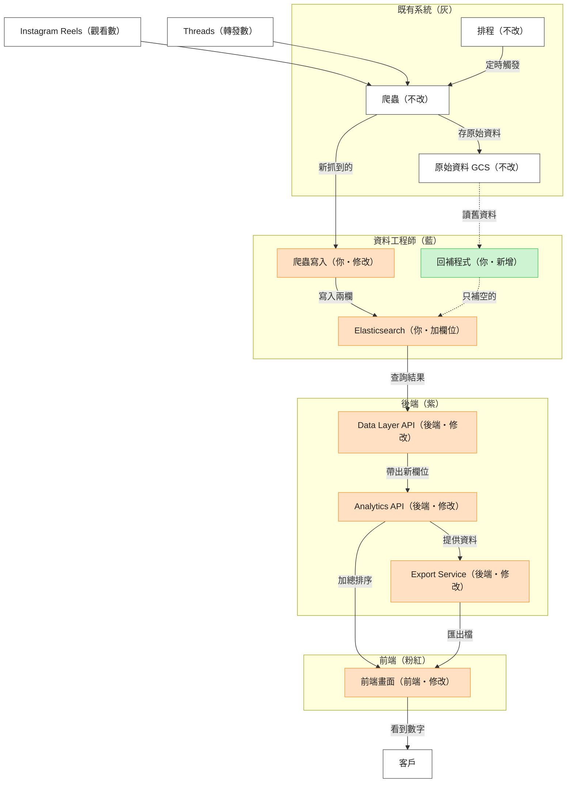
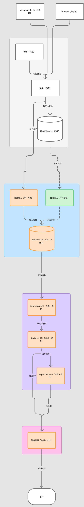
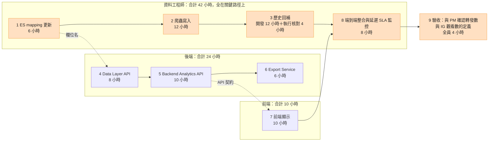
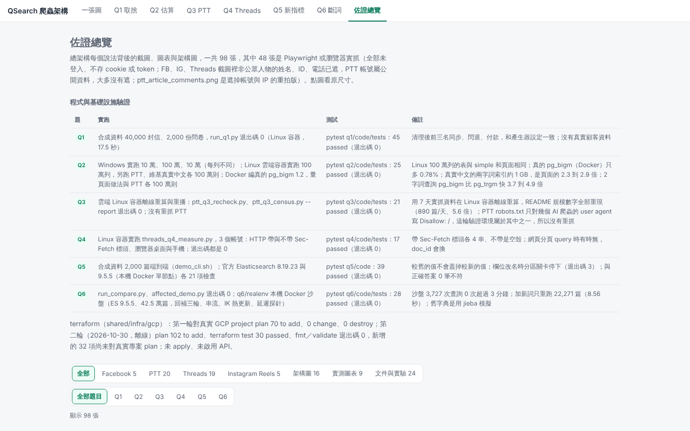
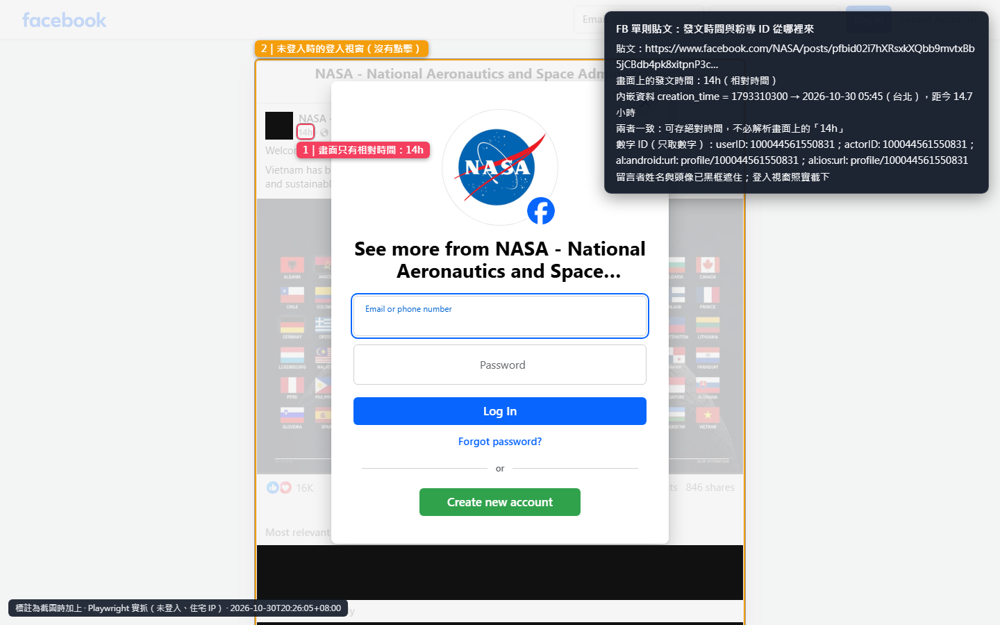
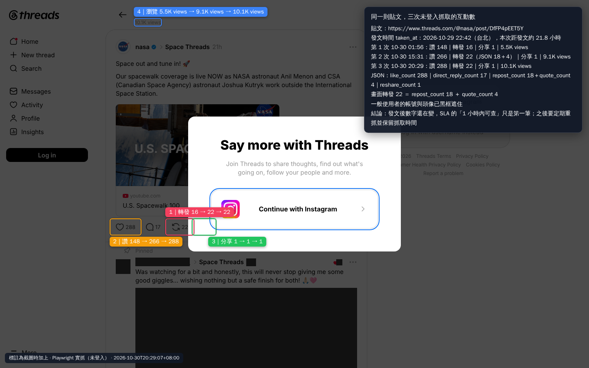
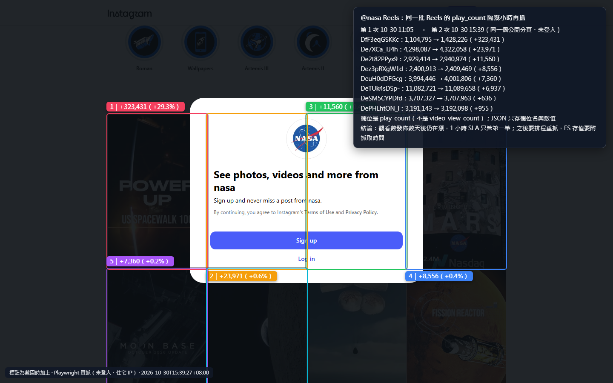

# QSearch 資料工程師筆試 Q1–Q6：總架構

**結論先行：** Serverless 為主、少數環節用常駐元件的實用混合。一個人維運、兩週上線的前提下，排程、派工、抓取、解析都用 Cloud Run、Cloud Tasks、Pub/Sub 等全託管服務；Threads 的 token 用 Cloud Run Job 跑無頭瀏覽器更新，固定出口 IP 用 Cloud NAT，Threads 抓取走每次請求換 IP 的住宅輪替代理；GKE 只留作備案（`shared/infra/gcp/optional/gke`，只做 validate 與替代 plan）。

本頁由總架構 artifact（https://claude.ai/artifact/CMCjqnWwiTYxcAukZHS2pT ）轉成文字與 Mermaid 圖，並併入 Q2 貼文表解剖頁與 Q5 FigJam 資料流。互動版與原 artifact 同色同版面：「一張圖」分頁只放「整合」這一張圖，可依題目 Q1–Q6 點亮節點；Q1 到 Q6 各有一個分頁，寫題目、答案重點、資料怎麼走、細節與限制、怎麼驗證的、還沒驗證的部分和該題佐證（Q2 分頁含估算解剖頁，Q5 分頁含資料流圖）；另有佐證總覽分頁：

- 線上：https://claude.ai/artifact/Bg2W8o5WkhVLpniJTXtRPm
- 本機：[shared/architecture/qsearch-architecture.html](shared/architecture/qsearch-architecture.html)



## 目錄

1. [Repo 結構](#repo-結構)
2. [Q1–Q6 索引](#q1q6-索引)
3. [六段管線](#六段管線)
4. [整合架構](#整合架構)
5. [題目專屬架構：Q2 與 Q5](#題目專屬架構q2-貼文表解剖與-q5-新指標資料流)
6. [真實截圖佐證](#真實截圖佐證)
7. [驗證狀態](#驗證狀態)
8. [證據等級](#證據等級)
9. [尚未補齊](#尚未補齊)
10. [相關文件](#相關文件)

## Repo 結構

根目錄只放本檔、六題資料夾、一個共用資料夾與 `.gitignore`。每一題的子資料夾用同一套名稱，但只建用得到的（q1 的答案寫在 README.md，只有 code/ 與 data/；q2 沒有 architecture/，q5 沒有 data/），找東西不用猜。唯一的例外是 q6/realenv/：Q6 真實環境的整套 Docker 環境，自帶 README、RESULTS 與 `run.sh`，放在一起才能照步驟原樣重跑。

```
README.md          總架構（本頁）
q1/ … q6/          每題一個資料夾
  README.md          題目、答案、證據索引
  answer/            答案全文與逐小題圖表
  architecture/      架構圖、資料流圖（src/ 是可編輯原檔與渲染腳本）
  code/              程式、tests/（pytest）、RESULTS.md（實跑指令、退出碼、結果）
  data/              實測輸出（CSV、JSON、log）
  evidence/          真實截圖（playwright/ 是共用腳本抓的，src/ 是截圖腳本）
  realenv/           只有 q6：官方 Elasticsearch、PostgreSQL、Pub/Sub 模擬器與監控的 Docker 整套
shared/            跨題共用
  architecture/      總架構 HTML／PNG、官方架構圖、GCP 與地端對照
  infra/gcp/         Terraform（Q2–Q6 共用的 GCP 資源）
  infra/onprem/      地端 docker compose（可實際啟動，smoke 19／19）
  infra/snippets/    Terraform 片段對照（terraform.json）與驗證筆記
  capture/           Playwright 共用截圖腳本、manifest、fixtures
  docs/              題目原文、六題合併答案、交接紀錄與各部分的驗證筆記
```

## Q1–Q6 索引

題目全文見 [shared/docs/qsearch_questions.md](shared/docs/qsearch_questions.md)。六題的正式答案合併在 [shared/docs/submission.md](shared/docs/submission.md)，字數用 python len（空白與換行都算）：Q1 397、Q2 585、Q3 785、Q4 600、Q5 598、Q6 599，都在各題上限內。

| 題號 | 題目（一句） | 資料夾 | 關鍵數字 | 證據等級 |
|---|---|---|---|---|
| Q1 | 三個資料來源擇二處理、揭露被放棄的來源 | [`q1/`](q1/README.md) | 處理客服信件與問卷、放棄社群貼文；三天分配 | B（推論）；答案第 3 點每一步都有原型，用合成資料 40,000 封信加 2,000 份問卷實跑（pytest 45） |
| Q2 | 100 萬則 FB 貼文的量級與中文索引選型 | [`q2/`](q2/README.md) | 表 1,024,000,000 B（約 977 MB）；兩字詞 GIN 約 387 MB；粉絲頁 ID btree 約 6.6 MB（MB 以 1,048,576 B 計，與 Q2 頁面相同）；真實中文 100 萬則的兩字詞索引 903–1,111 MB，387 MB 只是下限 | A（PostgreSQL 16.15 實跑 100 萬列：Linux 的表與 simple 和頁面逐位元組相同，兩字詞 −0.03%、pg_trgm +0.13%；真的 pg_bigm +0.78%；Windows 的 simple +43% 已查明） |
| Q3 | PTT 八卦板 7 天全文搜尋的 ETL 管線 | [`q3/`](q3/README.md) | 每天 890 篇；規格 2 每天 5,340 次，是規格 1 的 5.6 倍 | A |
| Q4 | Threads 40 萬帳號爬蟲的請求量、防封與代理成本 | [`q4/`](q4/README.md) | 每天 160 萬次（約 18.5 req/s）；單 IP 5 req/s 約 80 至 100 次即 401；代理約 2,800 至 4,500 美元／月 | A（實測），B（成本牌價） |
| Q5 | Reels 觀看數與 Threads 轉發數的全鏈路時間 | [`q5/`](q5/README.md) | 9 工作天，週一開工約 11 日曆天；關鍵路徑 46 小時：ES mapping、爬蟲寫入、回補、整合、驗收 | A（欄位；回補在官方 ES 實跑）、B（工時） |
| Q6 | 文字雲斷詞 pipeline 重建（回朔、字典、串流一致） | [`q6/`](q6/README.md) | 6,685 個標題實跑：前 50 詞的停用詞 10 降至 0、純數字與符號 12 降至 0、單字「高」222 降至 0；官方 Elasticsearch 9.5.5 回補 42.5 萬篇時全期查詢 p95 114 → 192 ms、沒有一次超過 3 分鐘，字典加一個詞只重跑 22,271 篇；150 個標題的金標詞召回從舊流程 64.7% 升到 75.6%，命中 300 萬篇的 terms 聚合 317 ms；正式答案 599 字（連空白與換行）；11 張架構圖、21 張佐證、30 張實測截圖 | A（實跑），舊字典為模擬 |

## 六段管線

資料單向流動：**排 → 派 → 抓 → 存 → 解 → 用**。

| 段 | 節點 | GCP 資源（Terraform 位址） | 地端對照 | 題號 |
|---|---|---|---|---|
| 1 排 | Cloud Scheduler `crawl-tick`；Q3 另有 `ptt-crawl-hourly` 每小時跑一次 Job | `google_cloud_scheduler_job.crawl_tick`、`google_cloud_scheduler_job.ptt_crawl_hourly` | cron 或 Airflow | Q3 |
| 1 排 | 排程大腦（圖上是 crawler-api；Terraform 由 scheduler 收 /tick、crawler-api 收 POST /crawl） | `google_cloud_run_v2_service.scheduler`、`google_cloud_run_v2_service.api` | FastAPI 加排程器 | Q3 |
| 1 排 | 狀態去重 | `google_sql_database_instance.crawler_db` | PostgreSQL | Q2 Q3 |
| 2 派 | Cloud Tasks ×5：fb／yt／news，加上每站限速的 crawl-ptt（1 rps）與 crawl-threads（20 rps） | `google_cloud_tasks_queue.crawl[...]`、`google_cloud_tasks_queue.crawl_site[...]` | RabbitMQ queue | Q3 Q4 |
| 2 派 | Pub/Sub crawler-tasks 與 DLQ（PoC） | `google_pubsub_topic.crawler_tasks`、`google_pubsub_subscription.crawl_sub`、`google_pubsub_topic.crawler_tasks_dlq` | RabbitMQ 加 DLX | Q3 |
| 3 抓 | Cloud Run crawler-worker | `google_cloud_run_v2_service.crawler_worker` | K8s worker | Q3 Q4 |
| 3 抓 | Cloud Run Job `ptt-crawl`（Q3 每小時抓新文章與 7 天內留言，經 Cloud NAT 出去） | `google_cloud_run_v2_job.ptt_crawl` | K8s CronJob | Q3 |
| 3 抓 | 住宅輪替代理（每次請求換 IP） | 外部服務；帳密的 Secret 容器已建、不存值：`google_secret_manager_secret.proxy_credentials` | 同左 | Q4 |
| 3 抓 | Cloud NAT 固定出口 | `google_compute_router_nat.crawler`、`google_compute_address.egress` | 出口閘道加固定 IP 或代理池 | Q4 |
| 3 抓 | 無頭瀏覽器、token 池 | 未涵蓋（Firestore 未寫） | Chromium 容器、Redis | Q4 |
| 3 抓 | GKE browser-pool／crawler（瀏覽器池備案，整合圖未畫） | `optional/gke`（validate 加替代 plan 8 to add，未對真實 project plan） | K8s Deployment 加 HPA | Q4 |
| 4 存 | GCS 原始檔（30 天轉 COLDLINE） | `google_storage_bucket.raw_scraped` | MinIO | Q3 Q5 Q6 |
| 4 存 | Pub/Sub 事件（Avro） | `google_pubsub_topic.qsearch_fetched`、`google_pubsub_schema.qsearch_event_v1` | Kafka 或 RabbitMQ 加 JSON schema | Q5 |
| 5 解 | Cloud Run parser | `google_cloud_run_v2_service.parser`、`google_pubsub_subscription.qsearch_parser_sub` | FastAPI consumer | Q3 Q5 Q6 |
| 5 解 | 資料品質閘門（Q1，非 infra） | 無 | 無 | Q1 |
| 5 解 | 斷詞 pipeline（Q6） | 未寫 Terraform（總架構畫在 parser 內；q6 設計是 parser 之後的獨立 Cloud Run 斷詞服務，回朔 Job 用同一映像） | 同左 | Q6 |
| 5 解 | 回補 Job | `google_cloud_run_v2_job.qsearch_backfill` | K8s Job 或 CronJob | Q5 Q6 |
| 6 用 | pg_bigm 搜尋庫（Q2 FB 貼文） | `google_sql_database_instance.crawler_db`（已開 `cloudsql.enable_pg_bigm` flag；`CREATE EXTENSION` 要在真實 project 驗證） | PostgreSQL 加 pg_bigm（地端已實測走索引） | Q2 |
| 6 用 | BigQuery 資料表（依發文日分區）與查詢 API（Q3 PTT 7 天） | 未寫 Terraform | PostgreSQL 全表掃描加 FastAPI（推論：7 天只有 22.9 MB，未實測） | Q3 |
| 6 用 | Elasticsearch 貼文索引（約 5 億筆） | 叢集未涵蓋；API key 的 Secret 容器已建：`google_secret_manager_secret.es_api_key` | OpenSearch | Q4 Q5 Q6 |
| 6 用 | BigQuery `ingest_events`（整合圖未畫） | `google_bigquery_table.ingest_events`、`google_pubsub_subscription.qsearch_to_bq` | ClickHouse | Q5 |
| 6 用 | Data Layer、Analytics、Export API、前端（QSearch 既有元件，Q5 要改） | 未涵蓋 | 同左 | Q5 |
## 整合架構

互動版的「一張圖」分頁只放「整合」這一張圖：它以 PoC 的六段管線為底，疊上 Q2 到 Q5 需要的元件（Q1 與 Q6 沒有新增節點，只點亮既有節點），13 個 GCP 節點旁附 Google Cloud 最新版官方圖示（cloud.google.com/icons 的 core-products 與 category 圖示包，不用 legacy 版）。下面的 Mermaid 圖把同一張圖轉成文字版，節點名稱與連線取自 [shared/architecture/qsearch-architecture.html](shared/architecture/qsearch-architecture.html)，純文字版在 [shared/architecture/artifact_text/int.txt](shared/architecture/artifact_text/int.txt)。






圖例與 artifact 相同：白框是「沿用 PoC」，綠框是「這次新增」，紫框是「題目透露的 QSearch 元件」，虛線框是「外部服務」，虛線箭頭是「控制／狀態」。有標籤的連線共六條：token 池到 crawler-worker 是「讀 token」，crawler-worker 到住宅輪替代理是「Threads」，crawler-worker 到目標平台是「PTT · FB 直連」，crawler-worker 到 Cloud Storage 是「原始檔」，crawler-worker 到 Pub/Sub 是「事件」，回補到 parser 是「重發事件」。

| 元件 | 角色 | 對應題號 |
|---|---|---|
| Cloud Scheduler `crawl-tick`（定時敲鐘） | 這次新增。只負責準時敲 crawler-api，這一輪抓什麼由 crawler-api 決定；PoC 原本只能手動 POST /crawl。 | Q2 Q3 Q4 Q5 |
| Cloud Run `crawler-api`（排程大腦） | 沿用 PoC。多一個 /tick，查 crawler-db 決定這一輪要抓哪些，放進對應來源的佇列；手動 POST /crawl 保留給補抓。 | Q2 Q3 Q4 Q5 |
| Cloud SQL `crawler-db`（狀態去重） | 沿用 PoC。Cloud Tasks 和 Pub/Sub 都是至少送達一次，同一個任務可能跑兩次，所以用 job_id 去重。 | Q2 Q3 Q4 |
| Cloud Tasks ×3（每個來源一條佇列） | 這次新增。PTT、Threads、FB 各一條佇列各自限速：PTT 每天約 6,300 次，每秒 1 次就夠；Threads 每天 160 萬次（18.5 req/s）。限速交給佇列，worker 程式裡不再 sleep。 | Q2 Q3 Q4 |
| token 池（Firestore · 跨帳號共用） | 這次新增。存 Threads 的 csrftoken 與 lsd，實測放 361 秒以上仍有效；worker 每分鐘讀一次放在記憶體。 | Q4 |
| Cloud Run Job `token-refresher`（無頭瀏覽器 · 每 5 分） | 這次新增。用無頭瀏覽器開 Threads 公開頁拿 token，寫進 token 池；瀏覽器只在這裡用，不需要另建 GKE 瀏覽器池。 | Q4 |
| Cloud Run `crawler-worker`（PTT · Threads · FB） | 沿用 PoC。一個服務三個 adapter，每個來源只寫 fetch(task) 與 parse(raw)；Threads 回 401 就換代理 IP，PTT 回 404 是刪文，要回 200 並標記刪除。 | Q1 Q2 Q3 Q4 Q5 |
| 住宅輪替代理（每次請求換 IP） | 外部服務。只有 Threads 走代理，因為同一個 IP 以每秒 5 次打約 80 至 100 次就回 401。成本是依牌價估算：每月流量約 1.5 TB（含 TLS 約 1.8 TB），IPRoyal 每 GB 1.84 美元約 2,800 至 3,300 美元，Oxylabs 每 GB 2.5 美元約 3,800 至 4,500 美元。 | Q4 |
| 目標平台（PTT · Threads · Meta） | 外部服務。PTT 沒有 API，八卦板要帶 over18=1 cookie；Threads 每帳號每輪一次 GraphQL POST；FB 用 Graph API，要通過 Page Public Content Access 審核。 | Q2 Q3 Q4 |
| Cloud Storage `raw-scraped-data`（原始檔 · 30 天轉冷） | 沿用 PoC，改 lifecycle。PoC 是 30 天就刪，Q5 要回補 2026/5/1 起的 IG 觀看數，所以改成 30 天轉冷、不刪除。 | Q1 Q2 Q3 Q4 Q5 Q6 |
| Pub/Sub `qsearch-crawl-fetched`（fetched 事件＋source） | 沿用 PoC。worker 存完原始檔才發事件；事件要有 source 欄位，parser 才知道交給哪個 adapter。 | Q2 Q3 Q4 Q5 Q6 |
| Cloud Run Jobs `qsearch-backfill`（回補：重放原始檔） | 這次新增。照日期分批讀 GCS 原始檔，重新發 fetched 事件給同一個 parser，新舊資料走同一套解析；用佇列控速，避免 ES 寫入拖慢線上查詢。這是 Q5 的做法；Q6 的回補 Job 用斷詞服務的同一個映像自己斷詞，直接寫 ES，不經 parser（見 [q6/README.md](q6/README.md)）。 | Q5 Q6 |
| Cloud Run `parser`（3 個 adapter） | 沿用 PoC。依 source 分流：PTT 沿用 repo 的選擇器，Threads 從 JSON 取 code、全文、taken_at；Q5 的兩個新欄位也在這裡加進 ES 文件。 | Q1 Q2 Q3 Q4 Q5 Q6 |
| pg_bigm 搜尋庫（Cloud SQL · Q2 FB 貼文） | 這次新增。Q2 的 100 萬則 FB 貼文搜尋用這台：pg_bigm 兩字一切，「台北」這種兩個字的查詢也用得到索引；只支援 LIKE，沒有相關度排序。Q3 的 PTT 搜尋不用這台，存在 BigQuery。 | Q2 |
| BigQuery（Q3 PTT 7 天 · 查詢 API） | 這次新增，和 Q3 答案一致。結果 MERGE 進 BigQuery，依發文日分區；查詢 API 用 Cloud Run，對 7 天分區做 LIKE 全掃，貼文和留言各查一次再合併。選 BigQuery 不選 pg_bigm：7 天純文字只有 22.9 MB，全掃不用建索引，也沒有資料庫主機要維護。查詢延遲沒有實測，1 到 3 秒是預估。 | Q3 |
| Elasticsearch（貼文索引 · 約 5 億筆） | 題目透露的 QSearch 元件。QSearch 實際存貼文的地方，約 5 億筆出自 Q6 題目；Q5 要在 mapping 新增 `video_view_count` 與 `text_post_app_info.repost_count`／`quote_count`／`reshare_count`（畫面上的轉發數是 repost_count 加 quote_count；artifact 節點說明只寫 `video_view_count` 與 `repost_count`（long）），mapping 可以加欄位、不能改型別。 | Q4 Q5 Q6 |
| Data Layer API（新增兩個欄位） | 題目透露的 QSearch 元件。Q5 要改的第 3 層，查 ES 時把兩個新欄位帶出來；實際怎麼部署題目沒說。 | Q5 |
| Analytics API（Backend 回傳新指標） | 題目透露的 QSearch 元件。Q5 要改的第 4 層，回傳觀看數與轉發數。 | Q1 Q5 |
| 前端（顯示觀看數、轉發數） | 題目透露的 QSearch 元件。Q5 要改的第 6 層；SLA 是發文 1 小時後查得到。 | Q5 Q6 |
| Export Service（匯出加兩欄） | 題目透露的 QSearch 元件。Q5 要改的第 5 層；它和前端都只依賴 Analytics API，兩邊可以平行開發（推論）。 | Q1 Q5 |

整合版以 PoC 的六段為底，補上三個缺口：定時排程、每個來源一條佇列、Threads 需要的住宅輪替代理與 token 池。派工從 PoC 的 Pub/Sub 換成 Cloud Tasks，是因為 Pub/Sub push 不能設「某個來源每秒最多幾次」，Cloud Tasks 每條佇列都能設。下游接上 Q2、Q3 的 pg_bigm 搜尋庫與搜尋 API，以及 Q5 從 Elasticsearch 經 Data Layer API、Analytics API 到前端與 Export Service 的鏈；原始檔改成轉冷不刪，回補 Job 才能重放舊原始檔，經同一個 parser 重算 Q5 的新欄位；Q6 的斷詞回補則由回補 Job 自己斷詞後直接寫 ES（見上表回補列）。題號欄取自互動版「依題目」按鈕點亮的節點：整合版子頁本身的標題寫 Q2–Q5，重建時在按鈕上加了 Q1 與 Q6。這個題號欄比 [六段管線](#六段管線) 表寬，例如 crawl-tick 在這裡是 Q2 Q3 Q4 Q5，六段管線表只列 Q3。

> 與 repo 實作的差異：整合版寫的佇列是 crawl-ptt、crawl-threads、crawl-fb；[shared/infra/gcp/scheduler_tasks.tf](shared/infra/gcp/scheduler_tasks.tf) 原本只有 crawl-fb、crawl-yt、crawl-news，第二輪驗證補上每站限速的 crawl-ptt（1 rps）、crawl-threads（20 rps）與 Cloud Tasks 以 OIDC 呼叫 worker 的權限鏈，三條舊佇列保留；Cloud Storage 節點說明寫 30 天轉 Archive，[shared/infra/gcp/storage.tf](shared/infra/gcp/storage.tf) 實作為轉 COLDLINE，bucket 名稱預設是 `<project_id>-raw-scraped`，不是 raw-scraped-data；整合版的 crawl-tick 敲 crawler-api 的 /tick，[shared/infra/gcp/scheduler_tasks.tf](shared/infra/gcp/scheduler_tasks.tf) 敲的是另一個 Cloud Run 服務 `scheduler`（[shared/infra/gcp/run.tf](shared/infra/gcp/run.tf)，最多 1 個實例）；repo 的 Pub/Sub `crawl-sub` 仍會 push 到 crawler-worker（[shared/infra/gcp/pubsub.tf](shared/infra/gcp/pubsub.tf)），但沒有每站速率上限，只留給 PoC，正式抓取改走 crawl-ptt、crawl-threads 兩條佇列；Q3 另外由 `ptt-crawl-hourly` 每小時直接執行 Cloud Run Job `ptt-crawl`。Q3 自己的答案架構（[q3/architecture/](q3/architecture)）是 Cloud Scheduler 每小時觸發 Cloud Run Job「crawl」，資料與爬蟲狀態都存 BigQuery，查詢服務只掃最近 7 天分區做子字串比對；整合版的儲存與查詢也是 BigQuery（和 Q3 答案一致），但 PTT 的抓取與解析畫在共用的 worker 與 parser；Q3 答案是 Job 自己解析後直接寫入，兩者寫進同一張表。整合版要求 fetched 事件帶 source 欄位，repo 的 [Avro schema](shared/infra/gcp/schemas/qsearch-crawl-event-v1.avsc) 與 parser 用 `platform` 欄位做同一件事。互動版節點面板替 crawl-tick、三條佇列、token-refresher、token 池、轉冷 bucket、pg_bigm 附的 Terraform 片段，artifact 自己都標為「未驗證」。

### GCP 與地端對照

各元件對應的 Terraform 資源與地端替代列在上方「六段管線」表；互動版點圖上的節點，面板會列出該節點的 GCP 資源、狀態（已 plan／第二輪離線 plan／未寫 Terraform 或部分涵蓋／外部服務）、地端與差異。文字版見 [shared/architecture/gcp-vs-onprem.md](shared/architecture/gcp-vs-onprem.md)（不含逐項狀態標籤）。狀態的意思：「已 plan」是第一輪對真實 GCP project plan 的 70 項（第二輪改過其中幾項的設定，例如 Cloud SQL 旗標與備份、Cloud Run 改成 internal ingress，這些改動只跑過離線 plan）；「第二輪離線 plan」是只跑過離線 plan 的項目（主模組新增的 32 項另跑過 terraform test，GKE 是另一個 root，只有 validate 與替代 plan）。成本：GCP 閒置約 US$104／月（約 NT$3,382，以第一輪 70 項計，其中 Cloud SQL 佔 US$100），是 Q2「每月 3,000 元」預算的 1.13 倍；Cloud SQL 改成 db-custom-1-3840，這一項約 US$51，還沒決定；地端估 NT$1,515–3,914，不含人力。細節見下方「驗證狀態」、[shared/infra/gcp/README.md](shared/infra/gcp/README.md)「第二輪驗證」與「成本」，以及 [shared/infra/onprem/VERIFY.md](shared/infra/onprem/VERIFY.md)。

## 題目專屬架構：Q2 貼文表解剖與 Q5 新指標資料流

Q2 與 Q5 各有一份比總架構更細的圖。Q2 是一張把 PostgreSQL 貼文表拆到 byte 的互動頁，Q5 是在 FigJam 畫的新指標資料流圖。本節整理兩者的重點，並對回總架構的節點。

### Q2

Q2 的頁面「Postgres 貼文表解剖」（線上：https://claude.ai/artifact/ESxb1xrXdAiT69ocVzbi43 ，原始碼：[q2/answer/fb_q2_posts_table.html](q2/answer/fb_q2_posts_table.html)）在 PostgreSQL 16.15 建了 100 萬則貼文，用 pageinspect 讀出第 0 頁的實際內容，再量三種中文全文索引。在總架構裡，這張表落在「pg_bigm 搜尋庫」節點（Cloud SQL）。

**一則貼文的組成。** 下表是頁面的推算，合計與 pageinspect 量到的 `lp_len` 918 B 相同。

| 欄位 | 算式 | 大小 |
|---|---|---|
| 內文 | 平均 250 字 × 3 B（UTF-8）＋ 4 B 長度 | 754 B |
| 心情互動統計 | 7 種心情 × 4 B 整數 | 28 B |
| 發文時間 | 時間戳記固定 8 B | 8 B |
| 粉絲頁名稱 | 假設 20 字 × 3 B ＋ 1 B 長度 | 61 B |
| 粉絲頁 ID | 15 位數字存成 8 B 整數 | 8 B |
| 貼文 ID（題目沒寫，自己補） | 31 字元 ＋ 1 B 長度 | 32 B |
| 每列固定開銷（PostgreSQL 規定） | 列標頭 24 B ＋ 對齊補 3 B | 27 B |
| 一則貼文 | 加總 | 918 B |

一頁 8,192 B 只放得下 8 則，所以每則實際占用 1,024 B，100 萬則是 977 MB，約 1 GB，這是 (a)。內文每兩個字切成一個詞，一則 250 字產生 249 個詞，100 萬則共 2.49 億筆（頁, 格）位址；以實測反推每筆 1.63 B，兩字詞索引是 388 MB，約原始資料的 40%，這是 (c)。頁面列出的 (b) 粉絲頁 ID 索引是 21 MB（每則不同粉絲頁）或 6.6 MB（5,000 個粉絲頁）。

**頁面數值與 100 萬列重跑。** 重跑用 Linux（雲端容器，PostgreSQL 16.15）。兩字詞索引用 GIN(array_ops) 對兩字詞陣列建立來模擬 pg_bigm，entry 數 248,926，與頁面的 248,925 幾乎相同；另在 Docker 裡用官方 PostgreSQL 16.15 映像編 pg_bigm 1.2，量真的 pg_bigm。

| 項目 | Q2 頁面 `const D` | Linux 100 萬列重跑 | 差異 |
|---|---|---|---|
| (a) 表 `pg_relation_size` | 1,024,000,000 B／125,000 頁 | 1,024,000,000 B／125,000 頁 | 0% |
| (c) 兩字詞 GIN（陣列模擬） | 406,396,928 B | 406,257,664 B | −0.03% |
| (c) 真的 pg_bigm GIN（Docker） | 未列 | 409,567,232 B | +0.78% |
| (c) pg_trgm GIN | 409,247,744 B | 409,788,416 B | +0.13% |
| (c) `to_tsvector('simple')` GIN | 3,268,608 B | 3,268,608 B | 0% |
| (b) btree(page_id) | `const D` 未列，頁面文字為 21 MB／6.6 MB | 6,873,088 B（造資料用 10,000 個粉絲頁） | 粉絲頁數不同，不直接比較 |

第一輪在 Windows（EDB 發行版）重跑時，simple 是 4,677,632 B（+43%），pg_trgm 是 409,526,272 B（+0.07%）。原因已查明：Windows 版把 U+9FC4 到 U+9FFF 這 60 個較新的 CJK 字當成非字母，`to_tsvector` 與 pg_trgm 會在這些字斷開。在 Linux 先把這 60 個字換成空白再建索引，兩種索引都和 Windows 逐位元組相同。真實中文幾乎不用這段字，但索引體積要在部署的平台（Linux 或 Cloud SQL）上量。真的 pg_bigm 多 0.78%，是因為它在每個詞頭尾各補一個空白，每則有 251 個兩字詞，模擬是 249 個。

`to_tsvector('simple')` 體積最小，是因為整段 250 字被當成一個詞。重跑時用第 1 列內文裡的 4 字詞查詢，它回傳 0 列，只有整段一模一樣才查得到；兩字詞索引與 pg_trgm 的 LIKE 查詢都回傳 1,000 列。

**決定選擇的數字。** 總架構頁 Q2 卡片的結論是：資料只有 GB 等級、每天 500 次查詢，一台小 Cloud SQL 加 pg_bigm 就夠，不必另外架搜尋叢集。撐起這句話的數字，Q2 頁面寫的是表 977 MB 加兩字詞索引 388 MB，合計 1.33 GB（頁面標題「PostgreSQL 裡面長什麼樣子」下方答案區的「兩者合計」），索引約為原始資料的 40%；總架構頁的卡片已改用真實中文的實測，合計約 2 GB，結論不變。

這個數字要和真實中文的實測一起看：

- 頁面與重跑的造資料方式都是「1,000 段內文，每段連續重複 1,000 次」，GIN 對連續位址壓縮得很好，所以 388 MB 只是下限。用真實中文 100 萬則（每則 250 字）實測，兩字詞索引是 903 MB（PTT 八卦板問答）到 1,111 MB（中文維基），是頁面的 2.3 到 2.9 倍、同語料表的 1.0 到 1.3 倍；真的 pg_bigm 在 PTT 資料上是 910 MB，只比模擬多 0.72%。所以 (c) 應該寫成「約與原始資料同大，100 萬則約 1 GB」，表加索引約 2 GB，仍是一台小 Cloud SQL 的量級。
- 選兩字詞（pg_bigm）而不選 pg_trgm，多了兩個實測理由：PTT 資料上 pg_bigm 比 pg_trgm 小 30%；高雄、颱風、政府這類 2 字詞湊不出三字詞，pg_trgm 退回全表掃描（0.54 到 0.66 秒），pg_bigm 走索引（119 到 147 毫秒）。服務若用 prepared statement，pg_trgm 的 2 字詞 LIKE 還會被 generic plan 拖到約 10 秒。
- 總架構頁先前那筆「全文索引 1 到 2.5 GB」的待辦找不到出處，已經拿掉，改用上面的實測。

完整對照、修正過程與重跑指令見 [q2/code/RESULTS.md](q2/code/RESULTS.md)，題目與檔案說明見 [q2/README.md](q2/README.md)。

### Q5

**資料流圖的來源。** Q5 (a) 的資料流圖畫在 FigJam（https://www.figma.com/board/69PjSj1MiGUqCfWTWIkzUa ）。整理這份 README 時 Figma 沒有連線，無法即時讀取白板本身，下面的圖是依 repo 裡的 PNG 匯出 [q5/architecture/diagram-dataflow-vertical-final.png](q5/architecture/diagram-dataflow-vertical-final.png) 重畫，方塊與箭頭的文字照抄匯出圖。

FigJam 圖的顏色有兩層意思（匯出的 PNG 上沒有圖例，說明取自 [q5/README.md](q5/README.md)）。方塊顏色表示要不要改：橘＝修改、綠＝新增、白＝不改。背景顏色表示誰負責：灰＝既有系統、藍＝資料工程師、紫＝後端、粉紅＝前端。方塊裡的「你」是答題者本人，也就是資料工程師。下面的 Mermaid 圖以節點顏色表示修改、新增、不改，以外框分組表示負責人；實線是新資料，虛線是歷史回補。



<details>
<summary>展開 FigJam 匯出原圖（直式最終版）</summary>



</details>

新資料走實線：排程定時觸發爬蟲，爬蟲把原始資料存進 GCS，新抓到的資料交給「爬蟲寫入」，把兩個新欄位寫進 Elasticsearch。歷史資料走虛線：回補程式讀 GCS 的舊資料，只補 ES 裡還是空的欄位。往下由 Data Layer API 帶出新欄位，Analytics API 一邊加總排序給前端畫面，一邊提供資料給 Export Service 產生匯出檔。題目把 Export Service 排在前端之前；圖上兩者的資料都來自 Analytics API，前端畫面另外接 Export Service 交出的匯出檔。總架構頁的節點說明推論兩者在開發上都只依賴 Analytics API，可以平行開發。

**與題目層級、總架構節點的對應。** 「排程」與「原始資料 GCS」參考的是 Google Drive 上的 QSearch 架構圖（Cloud Scheduler、Cloud Storage），題目本身沒有提到。

| 題目的層級 | FigJam 方塊 | 改動 | 負責 | 總架構節點 |
|---|---|---|---|---|
| 題目未提 | 排程（不改） | 不改 | 既有系統 | Cloud Scheduler `crawl-tick` |
| 爬蟲端已有欄位 | 爬蟲（不改） | 不改 | 既有系統 | Cloud Run `crawler-worker` |
| 題目未提 | 原始資料 GCS（不改） | 不改 | 既有系統 | Cloud Storage `raw-scraped-data` |
| 爬蟲寫入 | 爬蟲寫入（你・修改） | 修改 | 資料工程師 | Cloud Run `parser`（Q5 的兩個欄位在這裡加進 ES 文件） |
| ES mapping 更新 | Elasticsearch（你・加欄位） | 修改 | 資料工程師 | Elasticsearch 貼文索引（約 5 億筆） |
| 歷史資料回補 | 回補程式（你・新增） | 新增 | 資料工程師 | Cloud Run Jobs `qsearch-backfill` |
| Data Layer API 新增欄位 | Data Layer API（後端・修改） | 修改 | 後端 | Data Layer API |
| Backend Analytics API 回傳 | Analytics API（後端・修改） | 修改 | 後端 | Analytics API |
| Export Service 匯出 | Export Service（後端・修改） | 修改 | 後端 | Export Service |
| 前端顯示 | 前端畫面（前端・修改） | 修改 | 前端 | 前端 |

FigJam 圖把爬蟲到爬蟲寫入畫成一條「新抓到的」箭頭；在總架構裡，這一段中間還有 Pub/Sub `qsearch-crawl-fetched` 事件。回補的寫法在三份來源裡不完全一樣，這裡照實列出：

- FigJam 圖：回補程式讀 GCS 舊資料，直接寫 ES，只補空的欄位。
- [q5/answer/b-c-d.md](q5/answer/b-c-d.md) 的 (c)：預設對線上 index 做部分更新（bulk `update` 加 painless 腳本），每個計數欄位各帶一個時間戳 `counts_at.<欄位>`，較舊的值不會蓋掉爬蟲較新的寫入（前提是爬蟲每次寫計數也寫同一欄的 `counts_at`），重送只會得到 noop；建新 index（例如 `threads-posts-v2`）再用 alias 切換是備案，只在要改欄位型別時才划算。回補原型 [q5/code/backfill/backfill.py](q5/code/backfill/backfill.py) 產生 ES `_bulk` NDJSON 並限速送出，已在本機 Docker 的官方 Elasticsearch 8.19.23、9.5.5 實跑。
- 總架構頁的 Cloud Run Jobs `qsearch-backfill`：照日期分批讀 GCS 原始檔，重新發 `qsearch-crawl-fetched` 事件給同一個 parser，新舊資料走同一套解析。

三者都要原始檔還在才能回補。總架構頁指出 PoC 的原始檔 30 天就刪，2026/5/1 起的 IG 原始檔已經不在；超過 30 天的部分，要看爬蟲端原本把資料存在哪裡。目前 [shared/infra/gcp/storage.tf](shared/infra/gcp/storage.tf) 的預設是 30 天轉 COLDLINE、不刪除。

**Threads 的「轉發數」到底是哪個數字。** 2026/10/29 用 Playwright 在未登入、介面語言為繁體中文的狀態下打開 Threads 官方帳號 @threads 的公開頁，逐篇比對畫面數字與同一次載入的頁面 JSON。計數欄位在 `post.text_post_app_info`，同一層有 `repost_count`、`quote_count`、`reshare_count`、`is_markup`、`share_info`。截圖在 [q5/evidence/a-dataflow/](q5/evidence/a-dataflow)，逐張說明與核對結論見 [q5/README.md](q5/README.md) 的「Threads 真實畫面佐證」一節。

| 發現 | 實測 | 對設計的影響 | 截圖 |
|---|---|---|---|
| 畫面轉發數 ＝ `repost_count` ＋ `quote_count` | 範例 60 ＝ 35 ＋ 25。@threads 個人頁 16/16 篇，加上兩篇 Use media 相關貼文，共 18 篇全部符合；只看 `repost_count` 時，16 篇只有 1 篇對得上（那篇引用數剛好是 0） | 客戶要的「轉發數」是 API 的 `repost_count`，還是畫面上含引用的數字，上線前要先跟 PM 確認。回補原型只存兩個分量，畫面值在 Data Layer 計算 | [threads-repost-equals-repost-plus-quote.png](q5/evidence/a-dataflow/threads-repost-equals-repost-plus-quote.png)（圖上只看得到 60，35 與 25 在 FigJam 佐證區的 JSON 片段）；同一張圖看得到兩邊的是 [threads_post_repost_drift.png](q5/evidence/playwright/threads_post_repost_drift.png)（22 ＝ 18 ＋ 4） |
| `reshare_count` 是 null 不是 0 | 分享旁沒有數字時，JSON 的 `reshare_count` 是 `null`；16/16 篇 | 每一層都要存空值，不能補 0；前端對 null 顯示破折號，不顯示 0 | [threads-reshare-null-not-zero.png](q5/evidence/a-dataflow/threads-reshare-null-not-zero.png) |
| 「萬」是無條件捨去 | 讚 12,716 顯示 1.2 萬，74,572 顯示 7.4 萬，畫面最多差 999 | 爬蟲與回補都讀 JSON 整數，不抓畫面文字；回補原型遇到字串會標 `invalid_type`，當成「不知道」，不拿它蓋掉其他次抓取的值；所有抓取都不知道時，預設的部分更新不寫這一欄 | [threads-wan-truncated.png](q5/evidence/a-dataflow/threads-wan-truncated.png) |

手機 App 的轉發選單（[threads-app-repost-options-menu.png](q5/evidence/a-dataflow/threads-app-repost-options-menu.png)）顯示 Quote、Markup、Use media、Repost only 都從同一顆轉發按鈕按出來，所以按鈕旁的數字會把引用一起算進去。Markup 與 Use media 是否計入 `quote_count` 尚未實測。整張佐證區見 [threads-evidence-panel.png](q5/evidence/a-dataflow/threads-evidence-panel.png)，佐證區接在資料流圖旁的版本見 [q5/architecture/diagram-dataflow-with-threads-evidence.png](q5/architecture/diagram-dataflow-with-threads-evidence.png)。

**(b) 工時與關鍵路徑（估算，證據等級 B）。** 假設 1 位資料工程師、1 位後端、1 位前端平行作業，每天 8 小時，含自測，不含 PM 等待與 UAT。資料工程師合計 42 小時（含執行核對 4 小時），後端 24 小時，前端 10 小時。資料工程師只有一人，所以 1、2、3、8 依序排成一條線，接上全員驗收 9，就是關鍵路徑。



關鍵路徑是資料工程師的 42 小時加全員驗收 4 小時，共 46 小時。46 ÷ 每天 8 小時 ＝ 5.75 工作天，加 30% 給審查與修正是 7.475，取 8 工作天，再加 1 天緩衝，共 9 工作天；週一或週二開工跨一個週末，約 11 個日曆天（週三到週五開工跨兩個週末，約 13 個日曆天）。後端與前端不會拖慢上線，前提是 API 契約最晚在第 3 天結束前定案。逐層工時表、甘特圖，以及 (c) 回補風險與 (d) SLA 監控見 [q5/answer/b-c-d.md](q5/answer/b-c-d.md)；(d) 的判斷是最可能的瓶頸在爬蟲的抓取頻率，而不是 ES 寫入。測試共 39 項（回補 34、排程 5），全部通過。

## 真實截圖佐證

互動版「佐證總覽」分頁可依平台與題號篩選全部 98 張圖：四個平台的真實截圖 Facebook 5、PTT 20、Threads 19、Instagram Reels 5（含第二輪補拍，與下表一致），另有架構圖 16、實測圖表 9、文件與實驗 24。Q1 到 Q6 各題分頁也會列出該題的佐證。



除了一張 Threads App 轉發選單是使用者手機截圖（只裁選單），其餘全部用 Playwright 開未登入的公開頁實抓：不存 cookie、token，不用輪替代理或住宅代理，不登入（在雲端容器拍的圖照環境設定經過預設的出口代理連線，見 [shared/capture/capture_round2_cloud.js](shared/capture/capture_round2_cloud.js)）；FB、IG 的登入或註冊視窗照實截下，只有 q4/evidence 的三張 Threads 個人頁在截圖前用前端隱藏登入彈窗與遮罩；FB、IG、Threads 截圖裡非公眾人物的姓名與頭像已遮；PTT 帳號屬公開資料，不需要遮，PTT 截圖維持原圖，只有 `q3/evidence/playwright/ptt_article_comments.png`（留言者與作者帳號、IP）與 `q6/evidence/playwright/` 的 ptt_noise_01 到 06（作者或留言者 ID，部分另遮 IP、編輯者 ID 或電話）在拍攝時已加黑框，保留原樣。各題 `evidence/playwright/` 的 29 張圖與 2 份 JSON，主張、結果、抓取時間與更正記在 [shared/capture/capture_manifest.json](shared/capture/capture_manifest.json)（共 30 筆：29 張圖與 `ig_reel_fields.json` 各一筆，`ig_reels_play_count_drift.json` 記在對應截圖那筆的 `data` 欄）；q3/answer 的 8 張 PTT 截圖、q4/evidence 的 3 張與 q5/evidence/a-dataflow 的 9 張不在 manifest 裡，說明見各題 README.md，第二輪說明見 [shared/docs/playwright-round2.md](shared/docs/playwright-round2.md)。q6/evidence/realenv/ 的 30 張也不在 manifest 裡：五個渠道的公開頁 12 張（Facebook 4、Instagram 4、Threads 1、YouTube 2、中央社 1；FB、IG 用住宅網路拍，YouTube 有 1 張是 429 失敗紀錄），PM 頁與 Kibana、Grafana、Prometheus 的本機畫面 18 張，紀錄在該資料夾與 channels/ 的 screenshots.json 和 [q6/realenv/data/channels/COLLECTION.md](q6/realenv/data/channels/COLLECTION.md)。

| 平台 | 張數 | 位置 | 佐證什麼 |
|---|---|---|---|
| Facebook | 5 | [q2/evidence/playwright/](q2/evidence/playwright) | 住宅 IP 未登入：畫面只有「14h」，內嵌 `creation_time` 可存絕對時間；粉專透明度頁的 Page ID 和貼文頁的 profile ID 不同。雲端 IP 直接 302 到登入頁，所以量大時走 Graph API（Q2、Q4） |
| PTT | 20 | [q3/evidence/playwright/](q3/evidence/playwright)、[q3/answer/](q3/answer)（各小題 `ptt-*.png`）、[q6/evidence/playwright/](q6/evidence/playwright) | 列表頁固定 20 格、文章網址即發文時間、留言欄位大小、刪文 404、「檔案過大」截斷留言（Q3）；斷詞雜訊：短網址（reurl.cc、tinyurl.com、bit.ly）、電話、地名（Q6） |
| Threads | 19 | [q4/evidence/](q4/evidence)、[q5/evidence/a-dataflow/](q5/evidence/a-dataflow)、[q5/evidence/playwright/](q5/evidence/playwright) | 未登入可取 URL、全文、時間；個人頁 HTML 只內嵌 4 串，網頁自己送的分頁 GraphQL 時有時無（10/30 桌面 0/15、手機 1/3），doc_id 也會換；伺服器回的 HTML 已帶「Log in to see more」登入提示，但出現提示不代表停止分頁（Q4）；畫面轉發數 = `repost_count` + `quote_count`、`reshare_count` 為 null 不是 0、「萬」無條件捨去，三次抓取轉發 16 → 22 → 22（Q5） |
| Instagram Reels | 5＋2 份 JSON | [q5/evidence/playwright/](q5/evidence/playwright) | 欄位實際名稱是 `play_count`；同一批 Reels 隔 4.6 小時最新一支漲 29.3%；單支 Reel 頁未登入看不到觀看數；雲端 IP 被導去登入頁並回 429（Q5、Q4） |

<table>
<tr>
<td width="50%"><b>Facebook</b>：畫面「14h」對上內嵌 creation_time<br/></td>
<td width="50%"><b>PTT</b>：已填滿的列表頁固定 20 格<br/></td>
</tr>
<tr>
<td><b>Threads</b>：畫面轉發 22 = repost_count 18 + quote_count 4<br/></td>
<td><b>Instagram Reels</b>：play_count 隔 4.6 小時的漂移<br/></td>
</tr>
</table>

## 驗證狀態

| 項目 | 結果 |
|---|---|
| pytest（各題 `code/tests`；Q5 為 `code/backfill/tests` 與 `code/schedule/tests`；parser 為 `shared/infra/gcp/services/parser/tests`） | 294 項全過：Q1 45、Q2 25、Q3 21、Q4 17、Q5 39、Q6 28、parser 119，退出碼皆 0。第二輪在雲端 Linux 容器跑，10/31 Q2、Q3、Q4 各加 1 項答案字數測試、Q6 依審查加 5 項（原本 286 項）；整理 PR 時在另一個 venv 獨立重跑，併入後也是 294 項全過（Q4 的瀏覽器測試用容器內建的 Chromium） |
| 各題實跑 | 每題 `code/RESULTS.md` 記實跑指令、退出碼與數字；第二輪總覽與待決事項在 [shared/docs/python.md](shared/docs/python.md) |
| Q2 100 萬列實跑 | PostgreSQL 16.15（Linux）：表與 `simple` 和頁面逐位元組相同，兩字詞 GIN −0.03%、pg_trgm +0.13%；真的 pg_bigm（Docker 編 1.2）+0.78%；第一輪 Windows 的 `simple` +43% 已查明，在 Linux 重現到位元組。真實中文 100 萬則的兩字詞索引 903–1,111 MB，頁面的 388 MB 是下限（[q2/code/RESULTS.md](q2/code/RESULTS.md)） |
| Q5 回補（官方 Elasticsearch） | 本機 Docker 的官方 Elasticsearch 8.19.23 與 9.5.5 單節點各 21 項檢查：首次送出與正確答案 0 筆不符，整批重送全部 noop（[q5/code/RESULTS.md](q5/code/RESULTS.md)） |
| Q6 真實環境（`q6/realenv`） | 官方 Elasticsearch 9.5.5（smartcn、ICU、IK）、PostgreSQL、Pub/Sub 官方模擬器與 Prometheus／Grafana，全部在 Docker、零成本：42.5 萬篇回補時全期查詢 p95 從 114 ms 升到 192 ms，G3 閘門自動降速後通過，3,727 次查詢沒有一次超過 180 秒；加一個新詞只需重跑含該字串的 22,271 篇（8.6 秒），不含該字串的文章 0 篇受影響（[q6/realenv/RESULTS.md](q6/realenv/RESULTS.md)） |
| Q6 召回、查詢規模與版本（10/31 補驗） | 150 個標題做三組獨立的模型標註（不是人工標註），兩組以上同意才算金標詞（430 個）：金標詞召回舊流程 64.7%、10/30 規則 74.4%、10/31 規則 75.6%；ES 9.5.5 單節點 terms 聚合（size 50）命中 300 萬篇時精確 317 ms、抽樣 1% 14 ms，前 50 詞重疊 49/50；每筆輸出帶涵蓋 jieba 版本、HMM 設定、主字典、使用者字典、停用詞、標籤白名單與單字保留名單、固定 total 與 `segmenter.py` 原始碼的指紋，原文另記 `content_sha`（[q6/code/RESULTS.md](q6/code/RESULTS.md) 最後一節） |
| terraform fmt、init、validate（`shared/infra/gcp`） | 退出碼 0。第二輪用 Terraform 1.17.1、google provider 8.9.0；整理 PR 時用同版本在另一份複本獨立重跑，結果相同 |
| terraform plan，真實 project（第一輪，本機） | 70 to add，0 change，0 destroy。未 apply，未啟用 API |
| terraform plan，離線（第二輪，假 token、`-refresh=false`） | 102 to add，0 change，0 destroy（比第一輪多 32 項，沒有刪掉既有資源；可選開關全開時 109）。新增的 32 項還沒對真實 project plan 過；獨立重跑同為 102 |
| terraform test（mock provider） | 30 passed（獨立重跑相同）；8 個刻意改壞一行的變異全部被抓到 |
| 靜態檢查 | tflint 0 issues；trivy 的 HIGH 全部清掉；checkov 仍有 23／102 項未過，原因見 [shared/infra/gcp/README.md](shared/infra/gcp/README.md) |
| `shared/infra/gcp/optional/gke` | validate 通過；把 data source 換成字面值的替代 plan 為 8 to add |
| parser 服務（`shared/infra/gcp/services/parser`） | pytest 119 passed（3 個 venv；獨立重跑相同）；docker build 與容器 smoke，以非 root（uid 10001）執行，SIGTERM 停機 0.46 秒；Pub/Sub 模擬器實跑：合法事件 204，三種壞事件各投遞 5 次、每次回 422 後進 DLQ |
| 地端 docker compose（`shared/infra/onprem`） | 9 個常駐服務實際啟動，smoke 19 項連續 3 次全過；pg_bigm 1.2 實測走索引；只讀 repo 內 fixture，不連真實網站（[VERIFY.md](shared/infra/onprem/VERIFY.md)） |
| 連結檢查 | 所有 `.md`、`.html` 的相對連結 0 個失效 |
| 架構頁瀏覽器檢查 | 1440 與 390 寬、深色與淺色四種情境皆無橫向溢出，無 console 錯誤 |

## 證據等級

- **A 實測：** 有截圖、實跑結果或 terraform plan 佐證。
- **B 推論：** 由實測推導或估算，含工時與牌價。
- **C 弱：** 單一來源或尚未驗證。

## 尚未補齊

- 答案與 Terraform、整合圖的差異：Q3 的 BigQuery 表與查詢 API 沒有 Terraform，BigQuery 的查詢延遲也沒有實測（1 到 3 秒是預估），整合圖把 PTT 的解析畫在共用的 parser，Q3 答案是 Job 自己解析後直接寫入；Q2 答案為了放進每月 NT$3,000 選 db-custom-1-3840（約 NT$2,000），Terraform 預設仍是 db-custom-2-7680、POSTGRES_15。
- Q6 還沒證明的：剩下約 24% 漏掉的金標詞，主要是字典沒有的人名與新詞，以及標註者當成一個詞、jieba 切成兩段的複合詞（例如改變世界、護樹團體），兩類都要靠新詞發現進字典，樣本也只有 150 個標題，金標是模型標註、還沒有人工複核；5 億篇的查詢時間是單節點線性外推（約 50 秒），沒在正式叢集量；全量重跑「離峰約 6 晚」用的每秒 3,000 篇寫入上限是假設；`q6/data/segmented_ab.jsonl` 仍是 10/30 規則的輸出，沒有重產。
- Q3 這輪沒有重抓 PTT，數字是用 7 天實抓資料離線重算，原因與在自己電腦補跑的指令見 [q3/code/RESULTS.md](q3/code/RESULTS.md)。其餘限制見 [shared/docs/python.md](shared/docs/python.md) 第四節。
- Terraform 還沒涵蓋 Elasticsearch 叢集、Firestore session、Redis／Memorystore、Vector DB、監控、各服務映像建置、Data Layer／Analytics／Export API 與 GKE workloads；Cloud Tasks 以 OIDC 實際派送、Cloud SQL `CREATE EXTENSION pg_bigm`、IAM 資料庫登入、BigQuery 訂閱寫入要在真實 project 驗證，並重跑 plan（預期 102 to add）（見 [shared/infra/gcp/README.md](shared/infra/gcp/README.md)）。
- IG 單支 Reel 頁未登入看不到觀看數；FB、IG 只能用住宅 IP 拍，雲端 IP 會被導去登入頁。
- Q5 資料流圖用的是 FigJam 匯出的 PNG，FigJam 原檔不在 repo 裡。

## 相關文件

- 六題合併答案：[shared/docs/submission.md](shared/docs/submission.md)（由 [shared/docs/build_submission.py](shared/docs/build_submission.py) 從各題答案檔產生）
- 原總架構 artifact（非本帳號所有，不能原地更新）：https://claude.ai/artifact/CMCjqnWwiTYxcAukZHS2pT
- 新總架構 artifact（同色同版面，一張整合圖，加 Q1–Q6 各題分頁與佐證總覽）：https://claude.ai/artifact/Bg2W8o5WkhVLpniJTXtRPm
- Q2 原頁：https://claude.ai/artifact/ESxb1xrXdAiT69ocVzbi43 （原始 HTML：[q2/answer/fb_q2_posts_table.html](q2/answer/fb_q2_posts_table.html)）
- Q5 資料流 FigJam：https://www.figma.com/board/69PjSj1MiGUqCfWTWIkzUa （匯出 PNG：[q5/architecture/](q5/architecture)）
- 交接手冊：[shared/docs/HANDOFF.md](shared/docs/HANDOFF.md)
- GCP 與地端對照：[shared/architecture/gcp-vs-onprem.md](shared/architecture/gcp-vs-onprem.md)
- 官方架構圖：[shared/architecture/qsearch-official-infographic.png](shared/architecture/qsearch-official-infographic.png)
