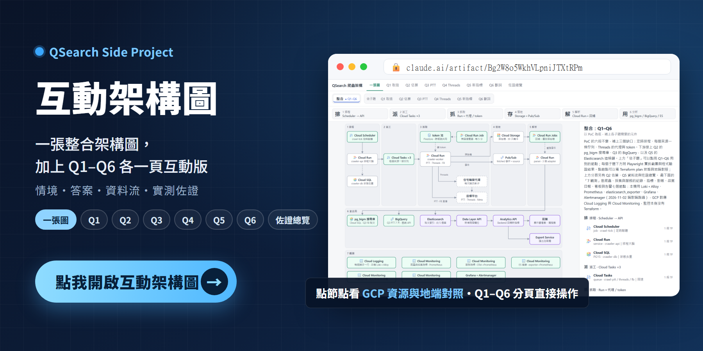

  <a href="https://claude.ai/artifact/Bg2W8o5WkhVLpniJTXtRPm"><b>點我開啟互動架構圖 →</b></a> 
  一張整合架構圖，加上六個模組各一頁（情境、瓶頸、解法、資料流、實測佐證）

## ARGUS 社群輿情情蒐平台

ARGUS 是我的 side project：六個渠道（Facebook、Instagram、Threads、YouTube、PTT 論壇、新聞媒體）的爬取、搜尋、斷詞、指標。程式、實跑紀錄、截圖都在這個 repo 裡。

## 六個模組

每個模組都從一個我實際卡住的瓶頸出發，拆開來各自設計、實作與實測。

**[一份看完：六個模組的設計摘要 →](shared/docs/design-summary.md)**

- [反饋分診：三通路顧客反饋排出前三大問題](shared/docs/design-summary.md#q1)
- [FB 貼文搜尋：100 萬則貼文的容量估算與選型](shared/docs/design-summary.md#q2)
- [PTT 全文搜尋：八卦板 7 天全文搜尋 ETL](shared/docs/design-summary.md#q3)
- [Threads 爬蟲：40 萬帳號、每天 4 輪](shared/docs/design-summary.md#q4)
- [新指標上線：Reels 觀看數與 Threads 轉發數](shared/docs/design-summary.md#q5)
- [文字雲斷詞重建：六渠道、約 5 億筆](shared/docs/design-summary.md#q6)

---

### 程式碼

各模組的程式、測試（pytest）與實跑紀錄（`RESULTS.md`）在各模組資料夾的 `code/`。

- [反饋分診：三通路顧客反饋排出前三大問題](q1/)
- [FB 貼文搜尋：100 萬則貼文的容量估算與選型](q2/)
- [PTT 全文搜尋：八卦板 7 天全文搜尋 ETL](q3/)
- [Threads 爬蟲：40 萬帳號、每天 4 輪](q4/)
- [新指標上線：Reels 觀看數與 Threads 轉發數](q5/)
- [文字雲斷詞重建：六渠道、約 5 億筆](q6/)

文字雲斷詞模組另有 [`q6/stack/`](q6/stack/)：整套系統的 Docker 組態與實跑紀錄（官方 Elasticsearch 9.5.5、PostgreSQL 16、Pub/Sub 模擬器、斷詞服務、文字雲 API 與 PM A/B 頁、Prometheus／Grafana／Loki／Alertmanager 監控），`run.sh` 一鍵啟動。

六個模組的互動版整合成一頁、用分頁切換：[`combined/`](combined/)，下載後用瀏覽器開 `combined/index.html`。

共用程式碼與 infra 在 [`shared/`](shared/)：[GCP Terraform 與 parser 服務](shared/infra/gcp/)・[地端 docker compose](shared/infra/onprem/)・[Playwright 截圖腳本](shared/capture/)・[情境描述與設計摘要](shared/docs/)

### 佐證截圖

| 模組 | 位置 | 內容 |
|---|---|---|
| FB 貼文搜尋 | [`q2/evidence/playwright/`](q2/evidence/playwright/) | FB 粉專與單則貼文：Page ID、內嵌的絕對發文時間、資料中心 IP 被導去登入頁 |
| PTT 全文搜尋 | [`q3/evidence/playwright/`](q3/evidence/playwright/)、[`q3/design/`](q3/design/) | PTT 看板索引、文章與推文、over18 關卡；各子問題的量測圖表；[`f12/`](q3/evidence/f12/) 是爬蟲設計依據的 F12 Network 截圖 7 張；[`grafana/`](q3/evidence/grafana/) 是 [`q3/pipeline/`](q3/pipeline/) 本機常駐運行、第一次回補、兩層故障演練與模擬器重啟後搜尋的看板截圖 |
| Threads 爬蟲 | [`q4/evidence/`](q4/evidence/) | Threads 個人頁、桌機與手機版、GraphQL 回應、貼文網址 |
| 新指標上線 | [`q5/evidence/`](q5/evidence/) | IG Reels 的 `play_count` 與單支頁、Threads 轉發數漂移；回補資料流 |
| 文字雲斷詞 | [`q6/evidence/`](q6/evidence/) | PTT 斷詞雜訊、回補／字典／一致性各子問題；[`stack/`](q6/evidence/stack/) 是整套系統的 PM A/B 頁、Grafana／Prometheus／Alertmanager／Kibana 與六渠道公開頁截圖；[`crawl/`](q6/evidence/crawl/) 是六渠道爬蟲監測看板 |
| 登入帳號重爬（Facebook、Instagram、Threads） | [`q6/evidence/meta-login/`](q6/evidence/meta-login/) | 同一批目標頁用登入帳號再爬一次：Facebook 4 → 65、Instagram 48 → 1,134、Threads 59 → 588 篇，登入牆 0 次；每個目標頁有頁面與 F12 Network 截圖各 2 張，共 60 張，加上 cookie → API → JSON → 欄位的證據鏈（FB 貼文搜尋、Threads 爬蟲、新指標上線、文字雲斷詞）；證據鏈圖、比對結果與程式在 [`chain/`](q6/evidence/meta-login/chain/)、[`q6/code/meta-login/`](q6/code/meta-login/)、[`q6/data/meta-login/`](q6/data/meta-login/) |
| Facebook 單則貼文逐欄 F12（登入帳號） | [`q2/evidence/f12/`](q2/evidence/f12/) | 貼文表每個欄位都翻到它在頁面資料的位置再截圖（20 張＋1 份 JSON）：貼文 ID、Page ID 與 profile ID、粉專名稱、`creation_time`、內文、七種心情、心情總數、分享數；心情數畫面不顯示（`HIDE_COUNTS`），只在資料與對話框 GraphQL 裡；一列 920 B 的逐 byte 配置在 [`q2/data/q2_row_layout_page0.json`](q2/data/q2_row_layout_page0.json) |
| 六渠道歷史爬蟲與規模試跑 | [`q6/evidence/history-crawl/`](q6/evidence/history-crawl/)、[`q6/evidence/scale-pilot/`](q6/evidence/scale-pilot/) | 2023-01 起的歷史爬蟲（[`q6/code/history-crawl/`](q6/code/history-crawl/)）執行中截圖 10 張、Grafana 看板 4 張、遙測統計與踩坑紀錄；單機 Elasticsearch 灌入 28.3 萬篇的規模試跑（[`q6/code/scale-pilot/`](q6/code/scale-pilot/)） |

全部證據依模組與平台整理在 [`shared/docs/evidence.md`](shared/docs/evidence.md)：實際網站截圖、F12／API／JSON 證據、登入 session、壓測與監控過程、實跑數字。每張截圖的主張、來源網址與截取時間列在 [`shared/capture/capture_manifest.json`](shared/capture/capture_manifest.json) 與各模組 README。
