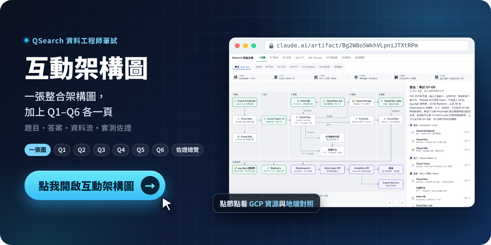

  <a href="https://claude.ai/artifact/Bg2W8o5WkhVLpniJTXtRPm"><b>點我開啟互動架構圖 →</b></a> 
  一張整合架構圖，加上 Q1–Q6 各一頁（題目、答案、資料流、實測佐證）

 

---

### 程式碼

各題的程式、測試（pytest）與實跑紀錄（`RESULTS.md`）在各題資料夾的 `code/`。

- [Q1 顧客反饋整理](q1/)
- [Q2 估算與選型：100 萬則 FB 貼文搜尋](q2/)
- [Q3 PTT 全文搜尋系統](q3/)
- [Q4 Threads 爬蟲系統](q4/)
- [Q5 新指標上線的全鏈路時間估算](q5/)
- [Q6 文字雲斷詞 Pipeline 重建](q6/)

共用程式碼與 infra 在 [`shared/`](shared/)：[GCP Terraform 與 parser 服務](shared/infra/gcp/)・[地端 docker compose](shared/infra/onprem/)・[Playwright 截圖腳本](shared/capture/)・[題目原文與合併答案](shared/docs/)
