# 登入帳號重爬 Facebook／Instagram／Threads：60 張截圖與證據鏈

2026-11-01 用一個登入帳號的 Chrome profile，把 Facebook、Instagram、Threads 同一批目標頁再爬一次，和原本的免登入爬蟲逐欄比對。每個目標頁都有 Playwright 頁面截圖（頂部、捲動後）與 F12 Network 視窗截圖（頂部、捲動後），再加上從 session cookie 到落地欄位的證據鏈。

- 截圖已遮掉帳號頭像、通知數與分頁標題（紅框處）；cookie 與 token 在紀錄檔裡一律只留 sha256 前 10 碼與長度，所有輸出檔掃過沒有任何原值。
- 每頁固定捲動 25 次、頁與頁之間間隔 5 秒以上、只讀不寫；免登入那一側沿用原爬蟲的結果，沒有改動。
- 對應題目：Q2（Facebook 貼文欄位）、Q4（Threads）、Q5（Instagram Reels）、Q6（六渠道歷史回補的可行性）。

## 一眼看完

| 平台 | 免登入 | 登入帳號 | 倍數 | 登入牆 · 最早一篇 |
|---|---|---|---|---|
| Facebook | 4 | 65 | ×16 | 登入牆 0 次｜最早 2026-10-30 03:40 |
| Instagram | 48 | 1,134 | ×24 | 登入牆 0 次｜最早 2026-04-06 00:42 |
| Threads | 59 | 588 | ×10 | 登入牆 0 次｜最早 2026-08-31 20:00 |

## 免登入 vs 登入帳號（同一批目標頁）

「x/y」是有值的篇數／總篇數。

### Facebook

| 欄位 | 免登入（原爬蟲） | 登入帳號 |
|---|---|---|
| 篇數 | 4 | 65 |
| 最早 | 2026-10-30 05:45 | 2026-10-30 03:40 |
| 最新 | 2026-11-01 05:15 | 2026-10-31 22:00 |
| 貼文 ID | 4/4 | 65/65 |
| 連結 | 4/4 | 60/65 |
| 發文時間 | 4/4 | 60/65 |
| 內文 | 4/4 | 65/65 |
| 作者 | 0/4 | 0/65 |
| 讚數 | 0/4 | 0/65 |
| 留言數 | 0/4 | 0/65 |
| 播放數 | 0/4 | 0/65 |
| 類型 | 4/4 | 65/65 |
| 各帳號篇數 | cnanewstaiwan 1、PNNPTS 1、ftvnews53 1、NASA 1 | cnanewstaiwan 56、PNNPTS 4、NASA 5 |

文字重疊：兩邊相同 3、只在免登入 1、只在登入 62。

### Instagram

| 欄位 | 免登入（原爬蟲） | 登入帳號 |
|---|---|---|
| 篇數 | 48 | 1,134 |
| 最早 | — | 2026-04-06 00:42 |
| 最新 | — | 2026-10-31 22:33 |
| 貼文 ID | 48/48 | 1134/1134 |
| 連結 | 48/48 | 1134/1134 |
| 發文時間 | 0/48 | 1134/1134 |
| 內文 | 48/48 | 1134/1134 |
| 作者 | 0/48 | 1134/1134 |
| 讚數 | 0/48 | 1134/1134 |
| 留言數 | 0/48 | 1134/1134 |
| 播放數 | 0/48 | 0/1134 |
| 類型 | 48/48 | 1134/1134 |
| 各帳號篇數 | cnanews_tw 12、pts.news 12、ftvnews 12、nasa 12 | cnanews_tw 312、pts.news 312、ftvnews 312、nasa 198 |

文字重疊：兩邊相同 44、只在免登入 4、只在登入 1,089。

### Threads

| 欄位 | 免登入（原爬蟲） | 登入帳號 |
|---|---|---|
| 篇數 | 59 | 588 |
| 最早 | 2026-10-12 17:14 | 2026-08-31 20:00 |
| 最新 | 2026-11-01 05:23 | 2026-11-01 06:00 |
| 貼文 ID | 59/59 | 588/588 |
| 連結 | 59/59 | 0/588 |
| 發文時間 | 59/59 | 588/588 |
| 內文 | 59/59 | 588/588 |
| 作者 | 0/59 | 588/588 |
| 讚數 | 0/59 | 588/588 |
| 留言數 | 0/59 | 0/588 |
| 播放數 | 0/59 | 0/588 |
| 類型 | 59/59 | 588/588 |
| 各帳號篇數 | cnanews_tw 11、pts.news 26、ftvnews 22 | cnanews_tw 177、pts.news 222、ftvnews 189 |

文字重疊：兩邊相同 20、只在免登入 39、只在登入 557。

## 驗證時抓到的問題

### Instagram 混入登入帳號本人的動態

登入後的頁面會夾帶首頁動態和推薦貼文，例如 dpk.ink、iamironj 這兩則同時被算進 4 個帳號。用「作者 = 目標帳號」剔除 134 筆，原始 1,268 筆保留，清洗後 1,134 筆才進比對。nasa 底下多數是合作作者（astro_*、nasajpl），規則一樣剔除。

剔除明細（來源頁 × 作者）

| 來源頁 | 作者 | 筆數 |
|---|---|---|
| nasa | astro_jessica | 15 |
| nasa | astro_christina | 14 |
| nasa | whitehouse | 12 |
| nasa | nasaadmin | 11 |
| nasa | nasaartemis | 10 |
| nasa | astro_reid | 9 |
| nasa | nasajohnson | 8 |
| nasa | astro_anil | 4 |
| nasa | nasdaq | 3 |
| nasa | nasajpl | 3 |
| nasa | nasawebb | 2 |
| nasa | eaglescheer | 2 |
| nasa | spherevegas | 2 |
| cnanews_tw | polomanbo | 1 |
| cnanews_tw | savewrg | 1 |
| cnanews_tw | mosseri | 1 |
| cnanews_tw_reels | dpk.ink | 1 |
| cnanews_tw_reels | iamironj | 1 |
| pts.news | savewrg | 1 |
| pts.news | dpk.ink | 1 |
| pts.news | iamironj | 1 |
| pts.news_reels | savewrg | 1 |
| pts.news_reels | dpk.ink | 1 |
| pts.news_reels | iamironj | 1 |
| ftvnews | savewrg | 1 |
| ftvnews | dpk.ink | 1 |
| ftvnews | iamironj | 1 |
| ftvnews_reels | dpk.ink | 1 |
| ftvnews_reels | iamironj | 1 |
| nasa | study_no.01 | 1 |
| nasa | iamironj | 1 |
| nasa | ua_athletics | 1 |
| nasa | astro_watkins | 1 |
| nasa | nasaaero | 1 |
| nasa | philadelphiaeagles | 1 |
| nasa | google | 1 |
| nasa | ravens | 1 |
| nasa | clevelandbrowns | 1 |
| nasa | steelers | 1 |
| nasa | jeopardy | 1 |
| nasa | nasamoonbase | 1 |
| nasa | soph_astro | 1 |
| nasa | slotus | 1 |
| nasa | nasascience_ | 1 |
| nasa | empirestatebldg | 1 |
| nasa | astro_chrisw | 1 |
| nasa | whostp47 | 1 |
| nasa | spotify | 1 |
| nasa | nasasolarsystem | 1 |
| nasa | nasaearth | 1 |
| nasa_reels | dpk.ink | 1 |
| nasa_reels | iamironj | 1 |

### IG 每帳號 312 篇是捲動上限

每頁固定捲 25 次，所以 4 個帳號都停在 312 篇左右。中央社回溯到 2026-04；民視一天發 30 多篇，312 篇只涵蓋 8 天。要到 2023-01，每帳號估計要捲數百次，會用登入帳號大量請求。

### 民視 FB（ftvnews53）0 篇

頁面本身顯示「目前無法查看此內容」，是網址代號不對，不是爬蟲失敗。需要正確的民視粉專網址。

### 欄位缺口

FB 兩邊都沒有讚數、留言數。Threads 登入版缺連結和留言數。IG 沒有播放數。

### 沒有外洩憑證

所有輸出檔掃過，沒有任何 cookie 或 token 原值。cookie 只留 sha256 前 10 碼和長度。截圖已模糊頭像、通知數和分頁標題（紅框處）。Threads F12 截圖的請求網址看得到 lsd 參數前幾碼，那是每次載入都換的防 CSRF 值，不是登入憑證。

## 證據鏈：session → API → JSON → 落地欄位

擷取時間 2026-11-01 05:31:43。每一格都來自擷取機器上的遮罩紀錄檔，可以和下方 F12 截圖裡的請求對照。cookie 只列名稱、網域、httpOnly 與長度；sha256 前 10 碼留在紀錄檔裡。

### Facebook（104 個 API 回應｜8 個 cookie）

**1. Session cookie（遮罩）**

| cookie | 網域 | httpOnly | 長度 |
|---|---|---|---|
| `datr` | .facebook.com | 是 | 24 |
| `sb` | .facebook.com | 是 | 24 |
| `wd` | .facebook.com | 否 | 8 |
| `dpr` | .facebook.com | 否 | 18 |
| `locale` | .facebook.com | 否 | 5 |
| `c_user` | .facebook.com | 否 | 15 |
| `xs` | .facebook.com | 是 | 93 |
| `fr` | .facebook.com | 是 | 120 |

**2. 頁面發出的 API 請求（次數最多的 10 個）**

| 請求 | doc_id | HTTP | 次數 |
|---|---|---|---|
| `ajax/bulk-route-definitions/` | — | 200 | ×44 |
| `ProfileCometTimelineFeedRefetchQuery` | 29067006279619311 | 200 | ×21 |
| `usePseudoBlockedUserInterstitialF3Query` | 40106045909008763 | 200 | ×5 |
| `FBYRPTimeLimitsEnforcementQuery` | 28597458263257974 | 200 | ×4 |
| `fetchMWChatVideoAutoplaySettingQuery` | 9713919638685405 | 200 | ×4 |
| `OhaiWebPublicKeyConfigQuery` | 26996952523264441 | 200 | ×4 |
| `RTWebCallBlockSettingHooksQuery` | 9989124061109700 | 200 | ×4 |
| `useMWEncryptedBackupsFetchBackupIdsV2Query` | 25220416984279164 | 200 | ×4 |
| `MAWVerifyThreadCutover_ContactCapabilities2Query` | 9948369021930229 | 200 | ×4 |
| `CometNotificationsDropdownQuery` | 40224765217121849 | 200 | ×4 |

**3. 回應 JSON 欄位路徑**

- `data.node.comet_sections.content.story.post_id`
- `data.node.comet_sections.content.story.text_format_metadata`
- `data.node.comet_sections.context_layout`
- `data.node.creation_time`
- `data.node.permalink_url`
- `data.node.post_id`
- `data.node.schema_context`
- `data.node.comet_sections.content.story.comet_sections.message.story.is_text_only_story`
- `data.node.comet_sections.content.story.comet_sections.message.story.permalink_url`
- `data.node.comet_sections.content.story.comet_sections.message.story.message.text`
- `data.node.comet_sections.content.story.comet_sections.message_container.story.message.text`
- `data.node.comet_sections.content.story.comet_sections.message_container.story.text_format_metadata`
- `data.node.attachments[].styles.attachment.title_with_entities.text`
- `data.node.comet_sections.content.story.message.text`
- `data.xfb_backup.virtual_devices[].creation_time`
- `data.viewer.notifications_page.edges[].node.header_link.text`

### Instagram（353 個 API 回應｜9 個 cookie）

**1. Session cookie（遮罩）**

| cookie | 網域 | httpOnly | 長度 |
|---|---|---|---|
| `datr` | .instagram.com | 是 | 24 |
| `ig_did` | .instagram.com | 是 | 36 |
| `mid` | .instagram.com | 是 | 28 |
| `wd` | .instagram.com | 否 | 8 |
| `dpr` | .instagram.com | 否 | 18 |
| `ig_nrcb` | .instagram.com | 否 | 1 |
| `csrftoken` | .instagram.com | 否 | 32 |
| `ds_user_id` | .instagram.com | 否 | 11 |
| `sessionid` | .instagram.com | 是 | 78 |

**2. 頁面發出的 API 請求（次數最多的 10 個）**

| 請求 | doc_id | HTTP | 次數 |
|---|---|---|---|
| `PolarisProfileReelsTabContentQuery_connection` | 39544804838467783 | 200 | ×101 |
| `PolarisProfilePostsTabContentQuery_connection` | 39527599490219966 | 200 | ×100 |
| `ajax/bulk-route-definitions/` | — | 200 | ×24 |
| `QuickPromotionSupportIGSchemaBatchFetchQuery` | 28774579702164828 | 200 | ×16 |
| `PolarisProfileStoryHighlightsTrayContentQuery` | 26970053832668570 | 200 | ×8 |
| `PolarisSchoolPartnerProfileBadgeQuery` | 28647748031575520 | 200 | ×8 |
| `PolarisProfilePageContentQuery` | 40158838120366999 | 200 | ×8 |
| `PolarisProfileNoteBubbleQuery` | 38260824646898178 | 200 | ×8 |
| `api/v1/web/fxcal/ig_sso_users/` | — | 200 | ×8 |
| `PolarisProfileSuggestedUsersWithPreloadableQuery` | 27929823133325729 | 200 | ×8 |

**3. 回應 JSON 欄位路徑**

- `data.fetch__XDTUserDict.clips_connection.edges[].node.media.code`
- `data.fetch__XDTUserDict.clips_connection.edges[].node.media.comment_count`
- `data.fetch__XDTUserDict.clips_connection.edges[].node.media.like_count`
- `data.fetch__XDTUserDict.clips_connection.edges[].node.media.play_count`
- `data.fetch__XDTUserDict.clips_connection.edges[].node.media.user.aigm_account_label_info.attribution_label_text`
- `data.fetch__XDTUserDict.clips_connection.edges[].node.media.user.username`
- `data.xdt_api__v1__feed__user_timeline_graphql_connection.edges[].node.caption.text`
- `data.xdt_api__v1__feed__user_timeline_graphql_connection.edges[].node.code`
- `data.xdt_api__v1__feed__user_timeline_graphql_connection.edges[].node.comment_count`
- `data.xdt_api__v1__feed__user_timeline_graphql_connection.edges[].node.fb_comment_count`
- `data.xdt_api__v1__feed__user_timeline_graphql_connection.edges[].node.fb_like_count`
- `data.xdt_api__v1__feed__user_timeline_graphql_connection.edges[].node.floating_context_items`
- `data.xdt_api__v1__feed__user_timeline_graphql_connection.edges[].node.like_count`
- `data.xdt_api__v1__feed__user_timeline_graphql_connection.edges[].node.link_text`
- `data.xdt_api__v1__feed__user_timeline_graphql_connection.edges[].node.social_context`
- `data.xdt_api__v1__feed__user_timeline_graphql_connection.edges[].node.taken_at`

### Threads（295 個 API 回應｜6 個 cookie）

**1. Session cookie（遮罩）**

| cookie | 網域 | httpOnly | 長度 |
|---|---|---|---|
| `ig_did` | .threads.com | 是 | 36 |
| `csrftoken` | .threads.com | 否 | 32 |
| `ds_user_id` | .threads.com | 否 | 11 |
| `sessionid` | .threads.com | 是 | 78 |
| `mid` | .threads.com | 否 | 28 |
| `dpr` | .threads.com | 否 | 4 |

**2. 頁面發出的 API 請求（次數最多的 10 個）**

| 請求 | doc_id | HTTP | 次數 |
|---|---|---|---|
| `useBarcelonaBatchedDynamicPostCountsSubscriptionQuery` | 39332564219721461 | 200 | ×120 |
| `ajax/bulk-route-definitions/` | — | 200 | ×80 |
| `BarcelonaProfileThreadsTabRefetchableDirectQuery` | 30052483217673456 | 200 | ×31 |
| `BarcelonaNotificationBadgeContextQueryDirectQuery` | 28611375835229448 | 200 | ×14 |
| `BarcelonaSideNavigationV2HomeItemQuery` | 28848004024811302 | 200 | ×4 |
| `BarcelonaSideNavigationFeedsListQuery` | 29121608777423756 | 200 | ×4 |
| `BarcelonaScreenTimeTrackingAndEnforcementLegacyIsSupervisedQuery` | 28402955199372659 | 200 | ×4 |
| `BarcelonaScreenTimeTrackingAndEnforcementLegacyAggregatedTimeTrackingEnabledQuery` | 29372209242368538 | 200 | ×4 |
| `BarcelonaScreenTimeTrackingAndEnforcementLegacyGetGuardianUsernameQuery` | 28353528304282482 | 200 | ×4 |
| `BarcelonaScreenTimeTrackingAndEnforcementLegacyDailyLimitAndQuietTimeQuery` | 27972217119144205 | 200 | ×4 |

**3. 回應 JSON 欄位路徑**

- `data.data.posts[].context__`
- `data.data.posts[].like_count`
- `data.data.posts[].text_post_app_info`
- `data.mediaData.edges[].node.thread_header_context`
- `data.mediaData.edges[].node.thread_items[].post.caption.text`
- `data.mediaData.edges[].node.thread_items[].post.caption.text_translation`
- `data.mediaData.edges[].node.thread_items[].post.code`
- `data.mediaData.edges[].node.thread_items[].post.context__`
- `data.mediaData.edges[].node.thread_items[].post.like_count`
- `data.mediaData.edges[].node.thread_items[].post.taken_at`
- `data.mediaData.edges[].node.thread_items[].post.text_app_glimmer_post_info`
- `data.mediaData.edges[].node.thread_items[].post.text_app_music_info`
- `data.mediaData.edges[].node.thread_items[].post.text_post_app_info`
- `data.mediaData.edges[].node.thread_items[].post.text_post_app_info.author_context_pill`
- `data.mediaData.edges[].node.thread_items[].post.text_post_app_info.ghost_post_approximate_like_count_str`
- `data.mediaData.edges[].node.thread_items[].post.text_post_app_info.text_fragments`

## 60 張截圖（已遮罩）

每個目標頁 4 張：頁面頂部、捲動 25 次後、F12 Network 頂部、F12 Network 捲動後。標題列的「API 回應」是 F12 裡記到的 GraphQL／API 回應數，「抓到」是落地的篇數（Instagram 的數字是清洗前）。

### Facebook

#### Facebook · cnanewstaiwan（HTTP 200 · 捲動 25 次 · API 回應 57 · 抓到 56 篇）

<table><tr>
<td width="50%"><b>頁面頂部</b> </td>
<td width="50%"><b>捲動後</b> </td>
</tr><tr>
<td width="50%"><b>F12 Network｜頂部</b> <a href="shots/facebook_cnanewstaiwan_devtools_F12.jpg">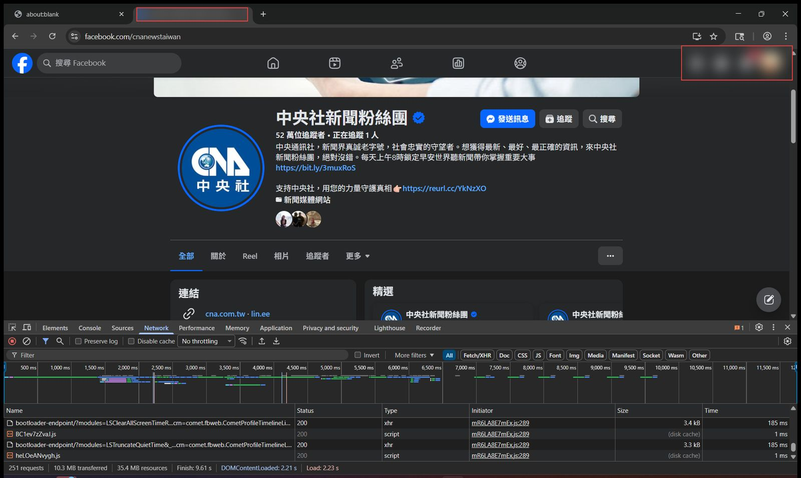</a></td>
<td width="50%"><b>F12 Network｜捲動後</b> <a href="shots/facebook_cnanewstaiwan_devtools_F12_after_scroll.jpg">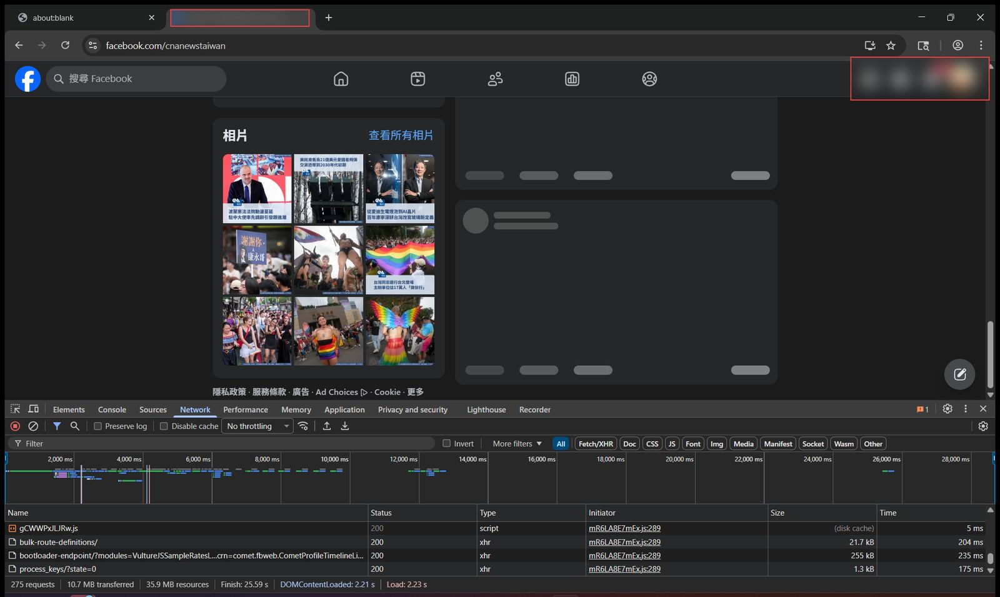</a></td>
</tr></table>

#### Facebook · PNNPTS（HTTP 200 · 捲動 25 次 · API 回應 19 · 抓到 4 篇）

<table><tr>
<td width="50%"><b>頁面頂部</b> <a href="shots/facebook_PNNPTS_top.jpg">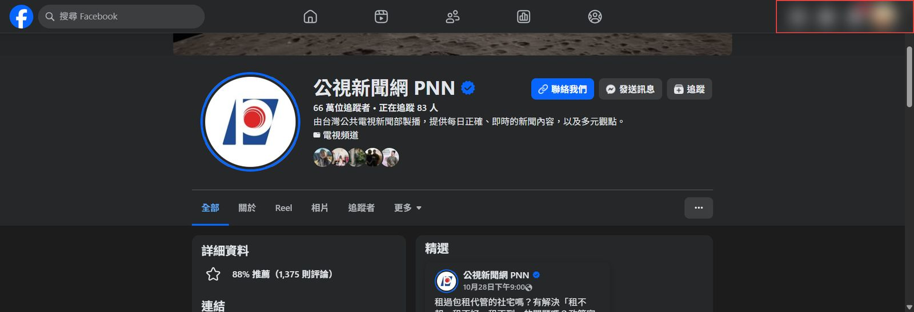</a></td>
<td width="50%"><b>捲動後</b> <a href="shots/facebook_PNNPTS_after_scroll.jpg">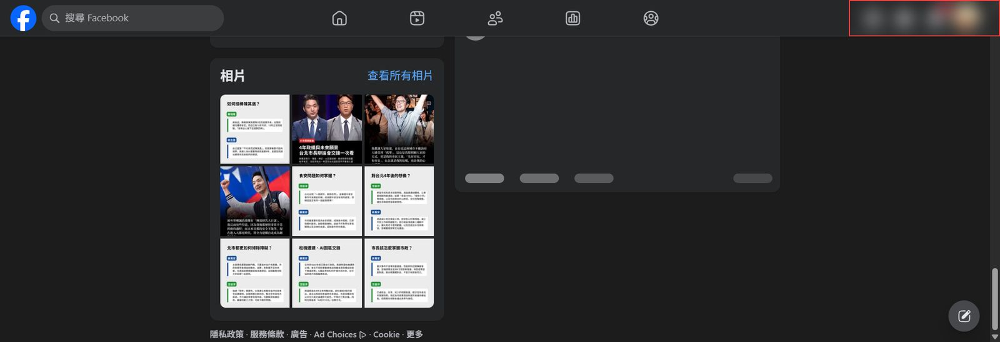</a></td>
</tr><tr>
<td width="50%"><b>F12 Network｜頂部</b> <a href="shots/facebook_PNNPTS_devtools_F12.jpg">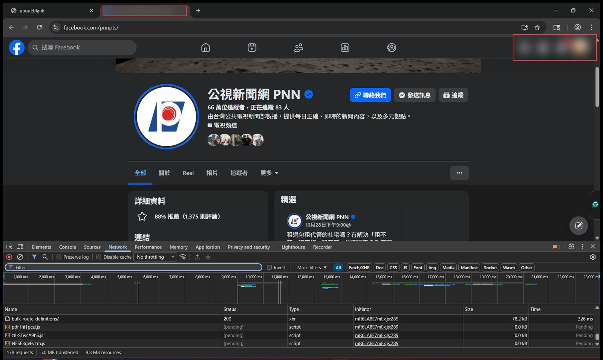</a></td>
<td width="50%"><b>F12 Network｜捲動後</b> <a href="shots/facebook_PNNPTS_devtools_F12_after_scroll.jpg">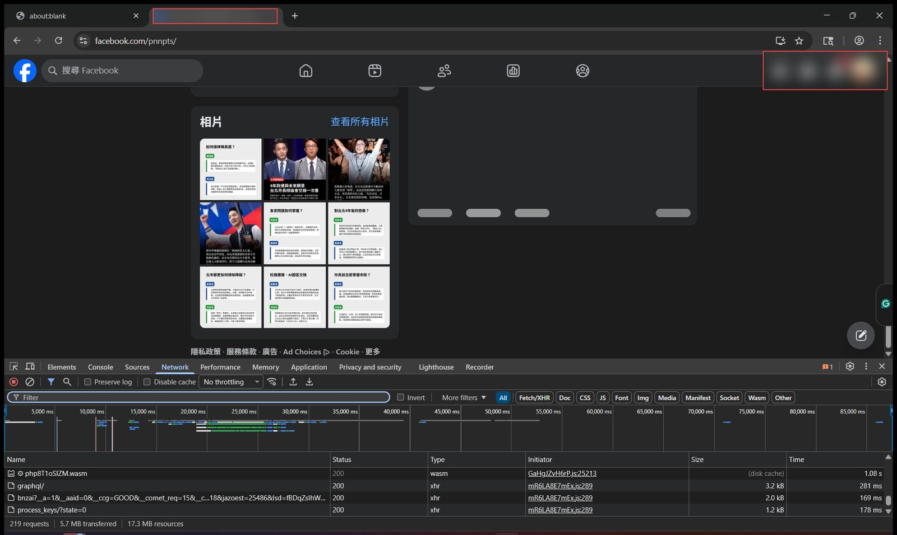</a></td>
</tr></table>

#### Facebook · ftvnews53（HTTP 200 · 捲動 25 次 · API 回應 11 · 抓到 0 篇）

<table><tr>
<td width="50%"><b>頁面頂部</b> <a href="shots/facebook_ftvnews53_top.jpg">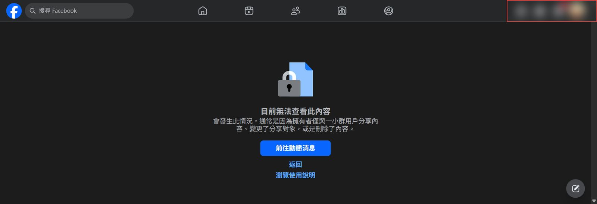</a></td>
<td width="50%"><b>捲動後</b> </td>
</tr><tr>
<td width="50%"><b>F12 Network｜頂部</b> <a href="shots/facebook_ftvnews53_devtools_F12.jpg">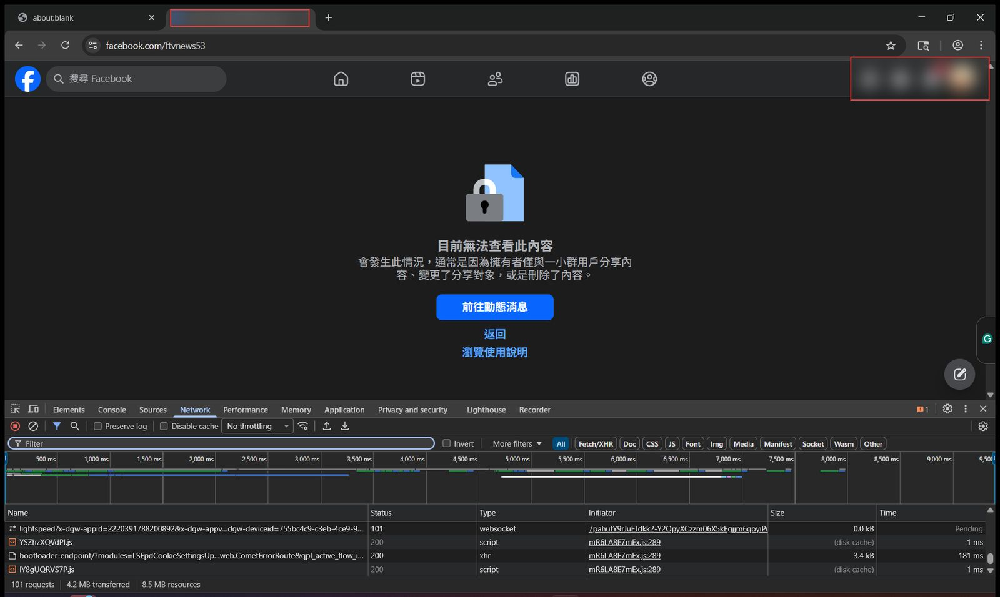</a></td>
<td width="50%"><b>F12 Network｜捲動後</b> <a href="shots/facebook_ftvnews53_devtools_F12_after_scroll.jpg">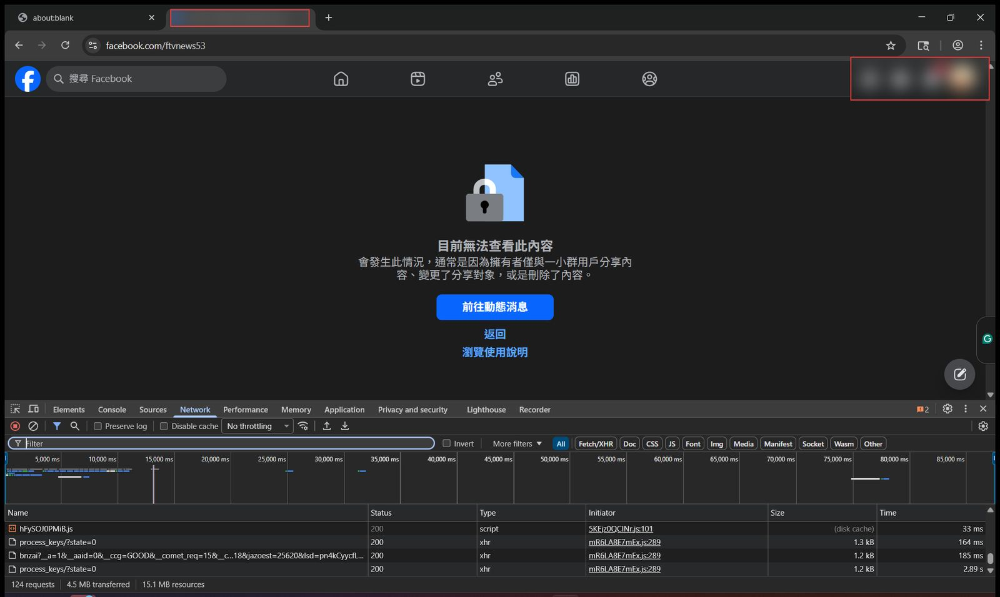</a></td>
</tr></table>

#### Facebook · NASA（HTTP 200 · 捲動 25 次 · API 回應 17 · 抓到 5 篇）

<table><tr>
<td width="50%"><b>頁面頂部</b> <a href="shots/facebook_NASA_top.jpg">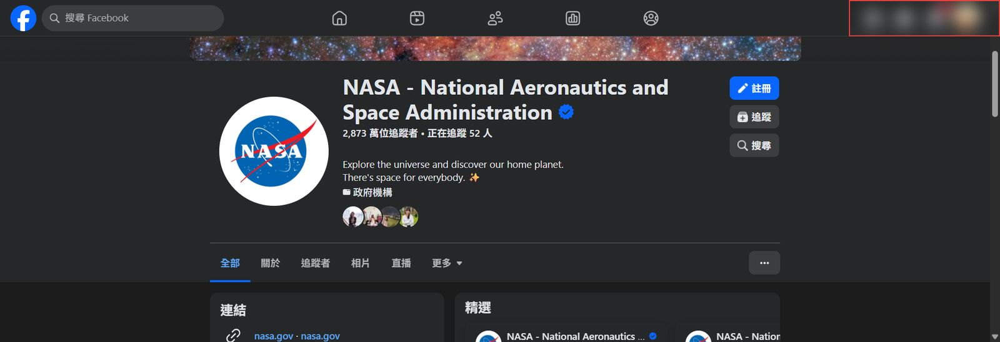</a></td>
<td width="50%"><b>捲動後</b> <a href="shots/facebook_NASA_after_scroll.jpg">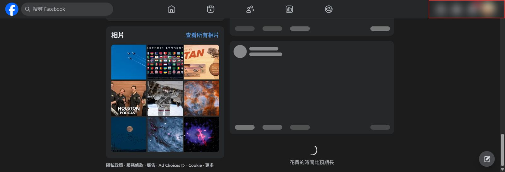</a></td>
</tr><tr>
<td width="50%"><b>F12 Network｜頂部</b> <a href="shots/facebook_NASA_devtools_F12.jpg">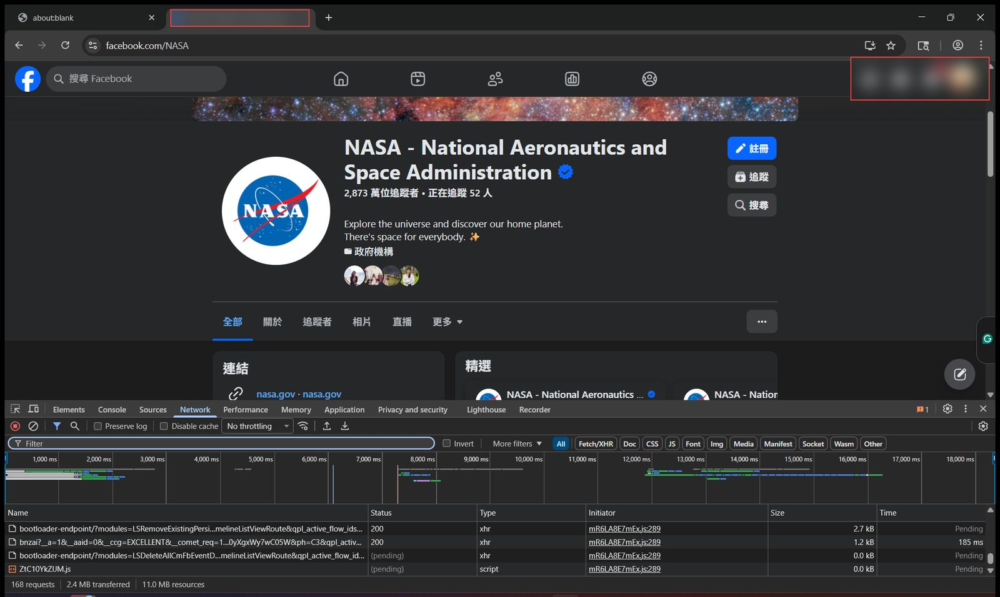</a></td>
<td width="50%"><b>F12 Network｜捲動後</b> <a href="shots/facebook_NASA_devtools_F12_after_scroll.jpg">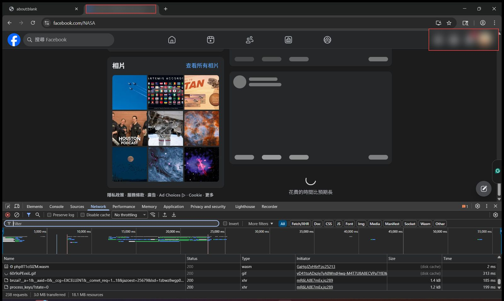</a></td>
</tr></table>

### Instagram

#### Instagram · cnanews_tw（HTTP 200 · 捲動 25 次 · API 回應 44 · 抓到 315 篇）

<table><tr>
<td width="50%"><b>頁面頂部</b> </td>
<td width="50%"><b>捲動後</b> <a href="shots/instagram_cnanews_tw_after_scroll.jpg">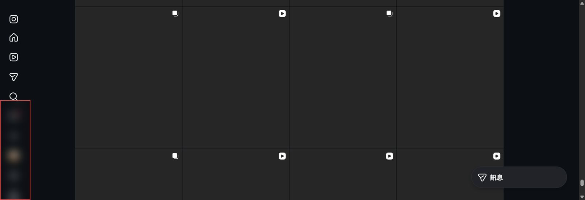</a></td>
</tr><tr>
<td width="50%"><b>F12 Network｜頂部</b> <a href="shots/instagram_cnanews_tw_devtools_F12.jpg">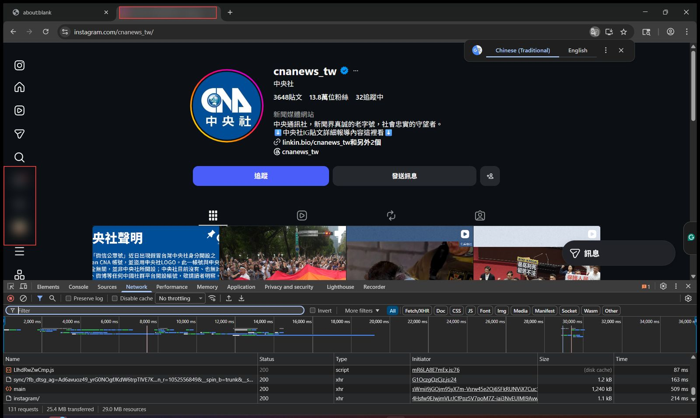</a></td>
<td width="50%"><b>F12 Network｜捲動後</b> <a href="shots/instagram_cnanews_tw_devtools_F12_after_scroll.jpg">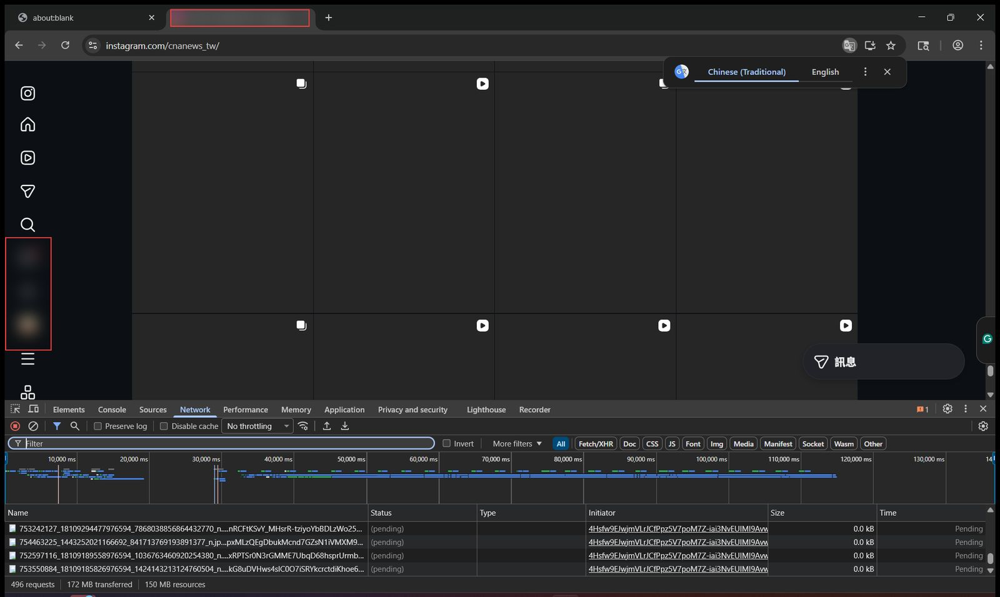</a></td>
</tr></table>

#### Instagram · cnanews_tw_reels（HTTP 200 · 捲動 25 次 · API 回應 44 · 抓到 2 篇）

<table><tr>
<td width="50%"><b>頁面頂部</b> <a href="shots/instagram_cnanews_tw_reels_top.jpg">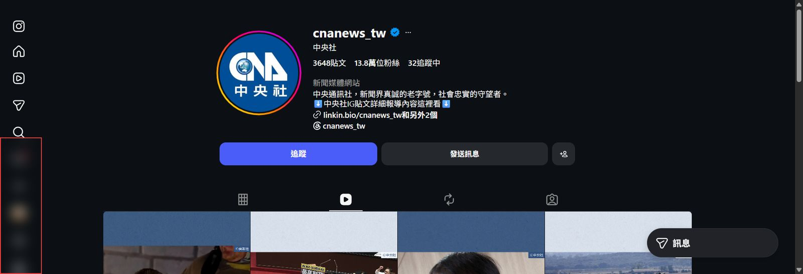</a></td>
<td width="50%"><b>捲動後</b> <a href="shots/instagram_cnanews_tw_reels_after_scroll.jpg">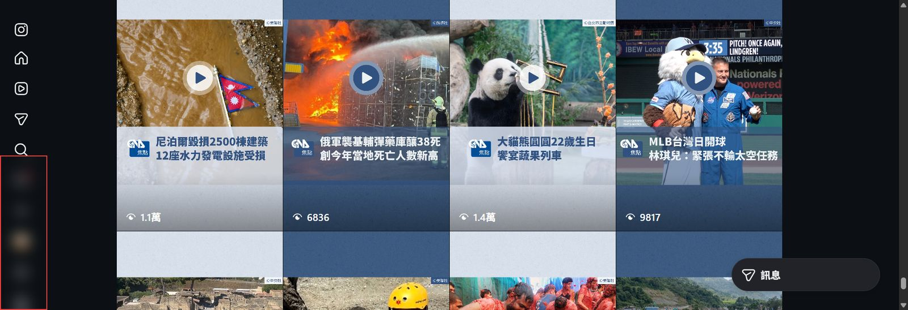</a></td>
</tr><tr>
<td width="50%"><b>F12 Network｜頂部</b> <a href="shots/instagram_cnanews_tw_reels_devtools_F12.jpg">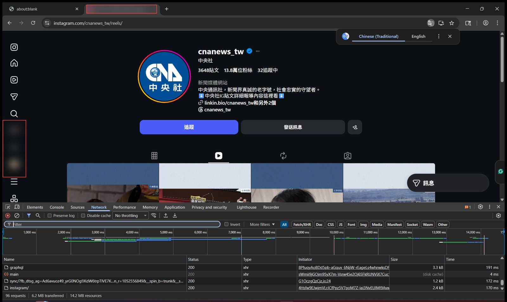</a></td>
<td width="50%"><b>F12 Network｜捲動後</b> <a href="shots/instagram_cnanews_tw_reels_devtools_F12_after_scroll.jpg">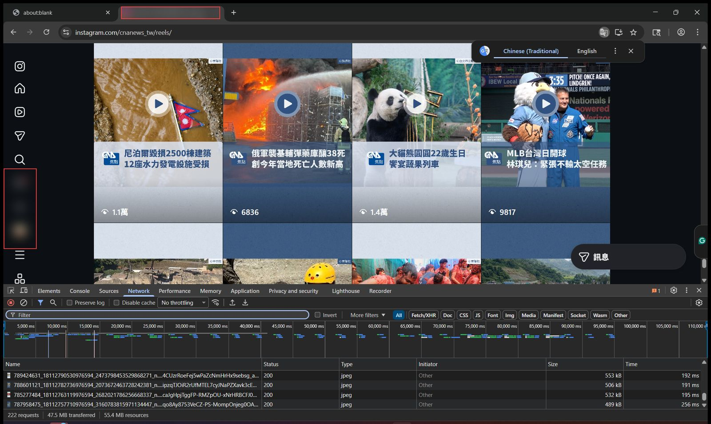</a></td>
</tr></table>

#### Instagram · pts.news（HTTP 200 · 捲動 25 次 · API 回應 45 · 抓到 315 篇）

<table><tr>
<td width="50%"><b>頁面頂部</b> </td>
<td width="50%"><b>捲動後</b> <a href="shots/instagram_pts_news_after_scroll.jpg">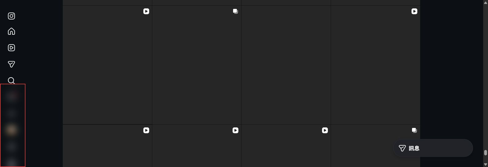</a></td>
</tr><tr>
<td width="50%"><b>F12 Network｜頂部</b> <a href="shots/instagram_pts_news_devtools_F12.jpg">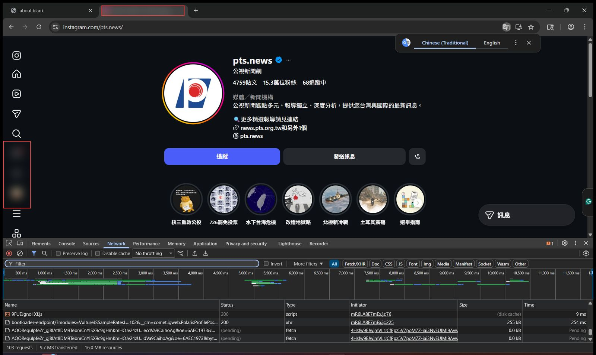</a></td>
<td width="50%"><b>F12 Network｜捲動後</b> <a href="shots/instagram_pts_news_devtools_F12_after_scroll.jpg">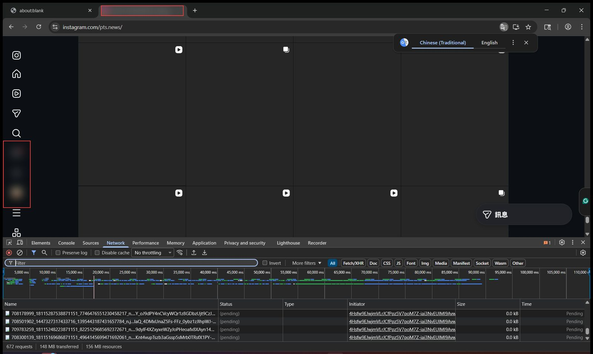</a></td>
</tr></table>

#### Instagram · pts.news_reels（HTTP 200 · 捲動 25 次 · API 回應 46 · 抓到 3 篇）

<table><tr>
<td width="50%"><b>頁面頂部</b> <a href="shots/instagram_pts_news_reels_top.jpg">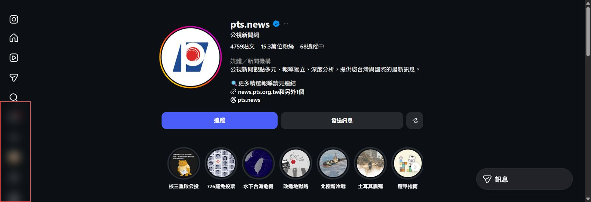</a></td>
<td width="50%"><b>捲動後</b> <a href="shots/instagram_pts_news_reels_after_scroll.jpg">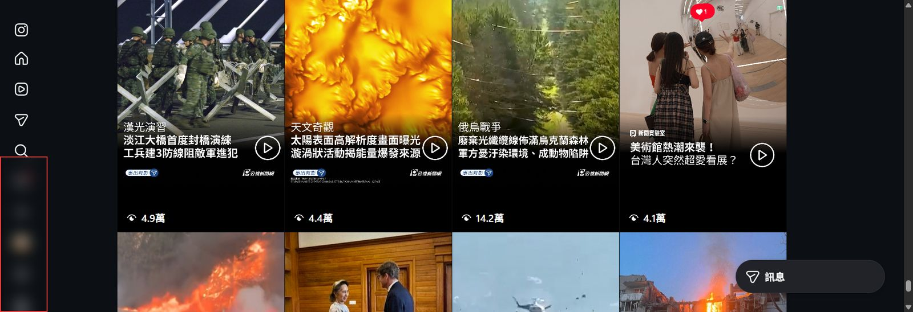</a></td>
</tr><tr>
<td width="50%"><b>F12 Network｜頂部</b> <a href="shots/instagram_pts_news_reels_devtools_F12.jpg">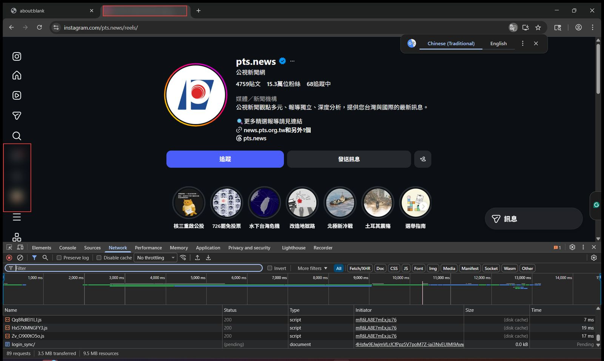</a></td>
<td width="50%"><b>F12 Network｜捲動後</b> <a href="shots/instagram_pts_news_reels_devtools_F12_after_scroll.jpg">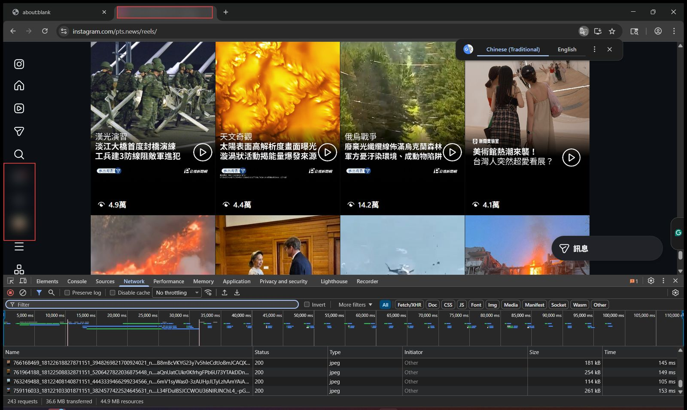</a></td>
</tr></table>

#### Instagram · ftvnews（HTTP 200 · 捲動 25 次 · API 回應 44 · 抓到 315 篇）

<table><tr>
<td width="50%"><b>頁面頂部</b> <a href="shots/instagram_ftvnews_top.jpg">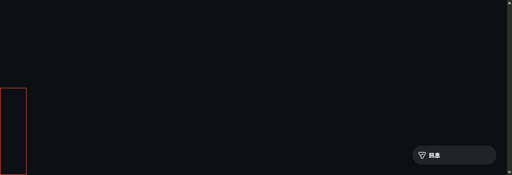</a></td>
<td width="50%"><b>捲動後</b> </td>
</tr><tr>
<td width="50%"><b>F12 Network｜頂部</b> <a href="shots/instagram_ftvnews_devtools_F12.jpg">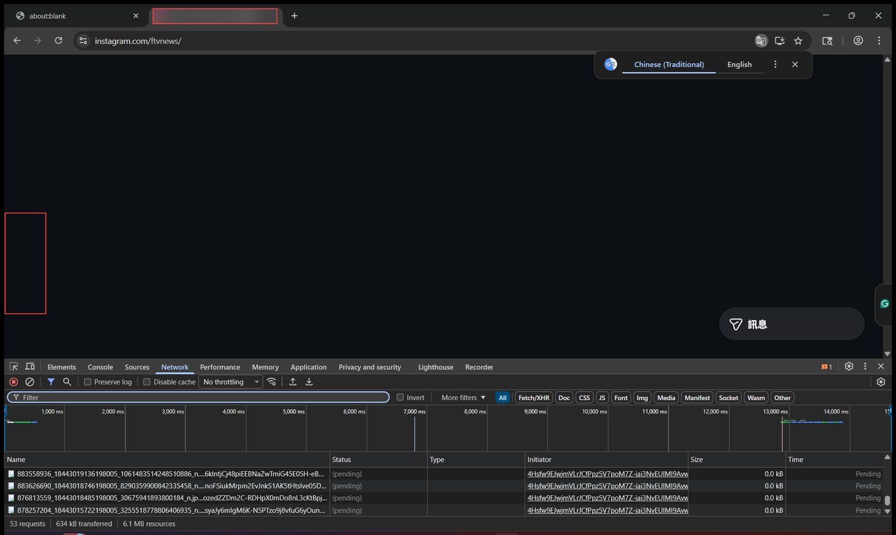</a></td>
<td width="50%"><b>F12 Network｜捲動後</b> <a href="shots/instagram_ftvnews_devtools_F12_after_scroll.jpg">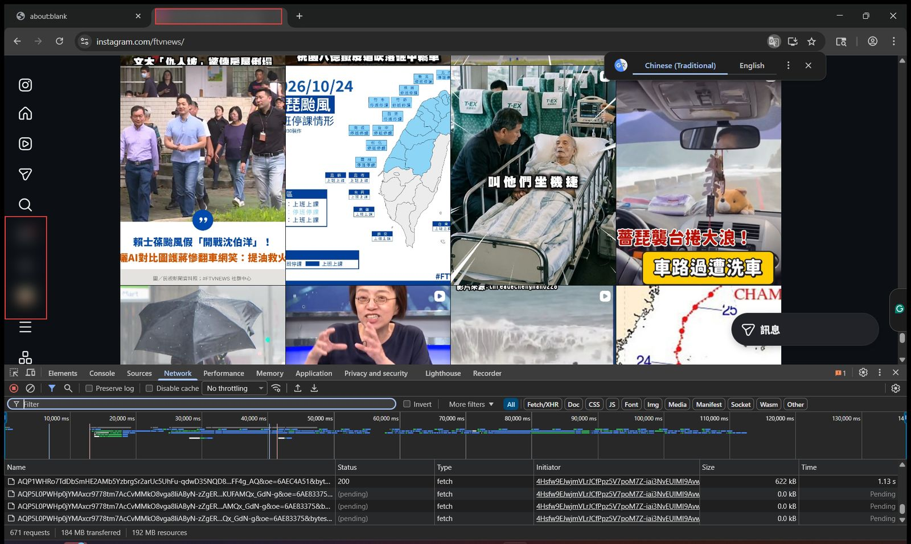</a></td>
</tr></table>

#### Instagram · ftvnews_reels（HTTP 200 · 捲動 25 次 · API 回應 43 · 抓到 2 篇）

<table><tr>
<td width="50%"><b>頁面頂部</b> <a href="shots/instagram_ftvnews_reels_top.jpg">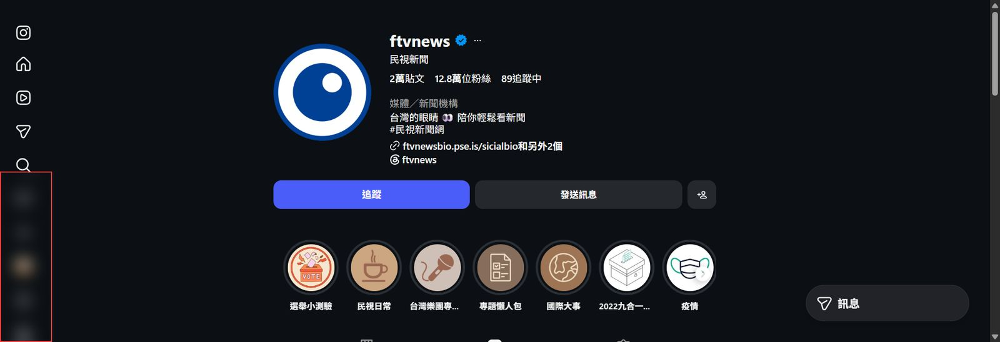</a></td>
<td width="50%"><b>捲動後</b> </td>
</tr><tr>
<td width="50%"><b>F12 Network｜頂部</b> <a href="shots/instagram_ftvnews_reels_devtools_F12.jpg">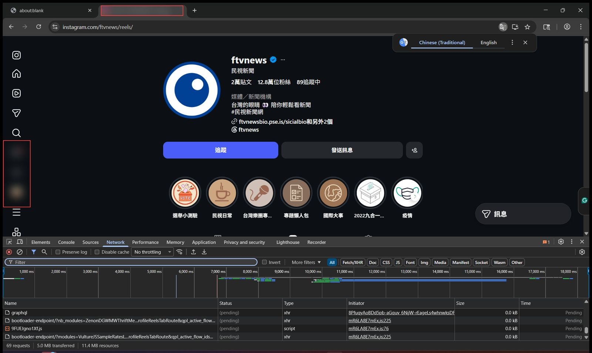</a></td>
<td width="50%"><b>F12 Network｜捲動後</b> </td>
</tr></table>

#### Instagram · nasa（HTTP 200 · 捲動 25 次 · API 回應 44 · 抓到 314 篇）

<table><tr>
<td width="50%"><b>頁面頂部</b> <a href="shots/instagram_nasa_top.jpg">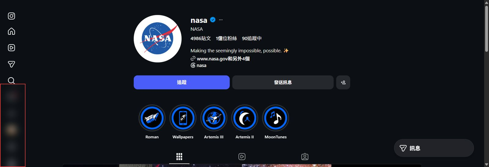</a></td>
<td width="50%"><b>捲動後</b> <a href="shots/instagram_nasa_after_scroll.jpg">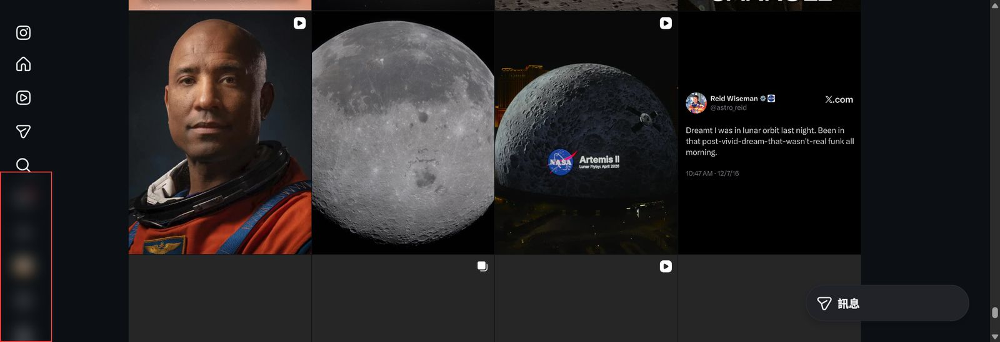</a></td>
</tr><tr>
<td width="50%"><b>F12 Network｜頂部</b> <a href="shots/instagram_nasa_devtools_F12.jpg">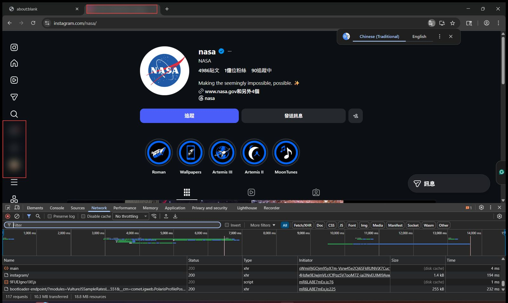</a></td>
<td width="50%"><b>F12 Network｜捲動後</b> <a href="shots/instagram_nasa_devtools_F12_after_scroll.jpg">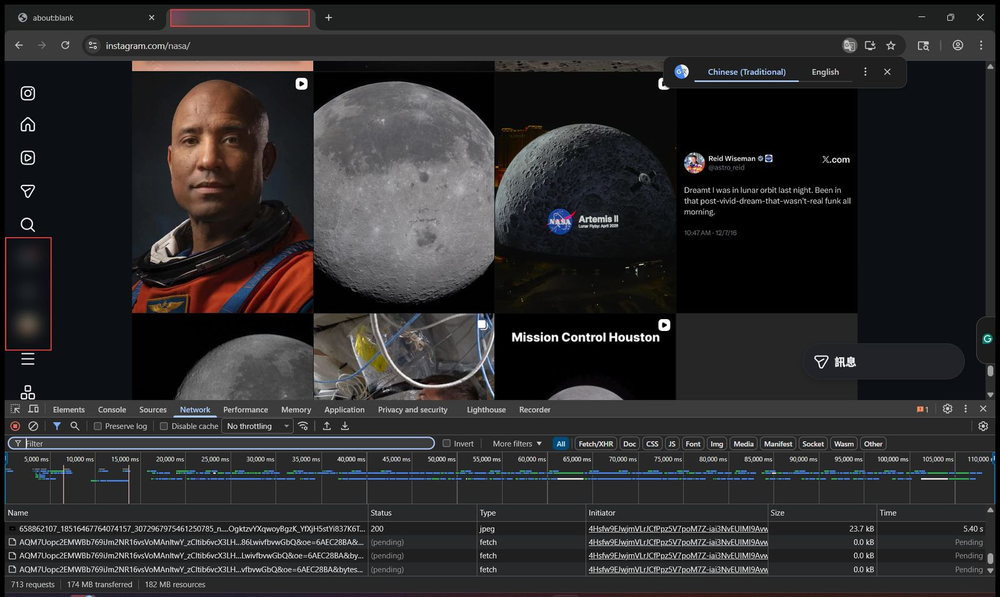</a></td>
</tr></table>

#### Instagram · nasa_reels（HTTP 200 · 捲動 25 次 · API 回應 43 · 抓到 2 篇）

<table><tr>
<td width="50%"><b>頁面頂部</b> <a href="shots/instagram_nasa_reels_top.jpg">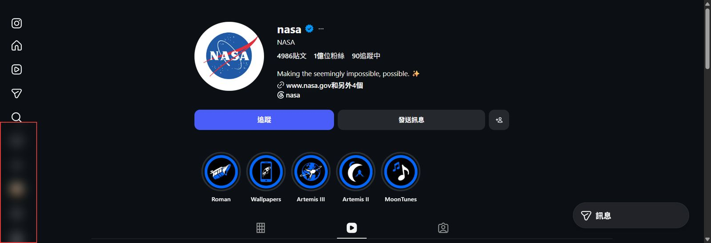</a></td>
<td width="50%"><b>捲動後</b> <a href="shots/instagram_nasa_reels_after_scroll.jpg">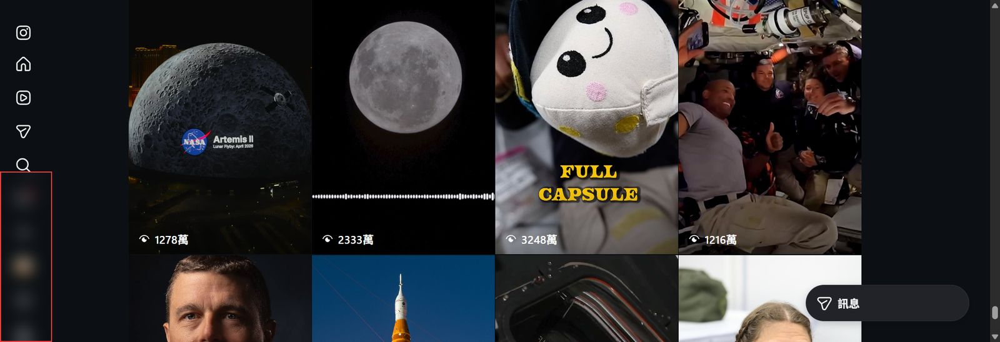</a></td>
</tr><tr>
<td width="50%"><b>F12 Network｜頂部</b> <a href="shots/instagram_nasa_reels_devtools_F12.jpg">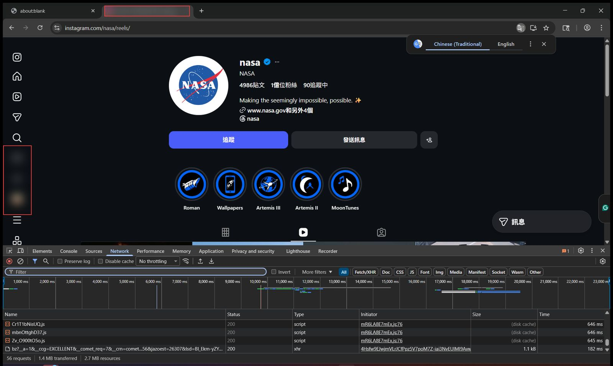</a></td>
<td width="50%"><b>F12 Network｜捲動後</b> <a href="shots/instagram_nasa_reels_devtools_F12_after_scroll.jpg">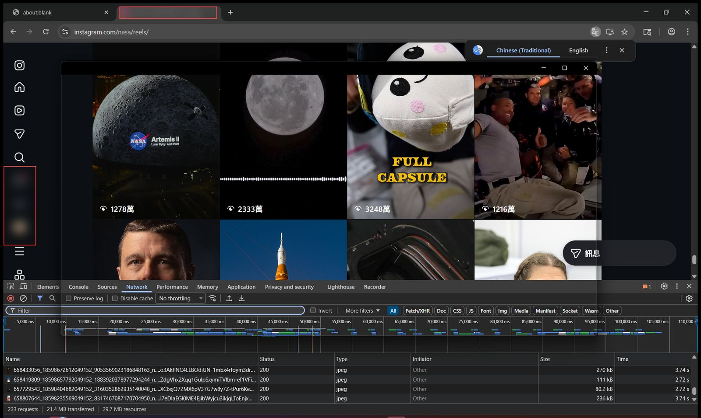</a></td>
</tr></table>

### Threads

#### Threads · cnanews_tw（HTTP 200 · 捲動 25 次 · API 回應 91 · 抓到 177 篇）

<table><tr>
<td width="50%"><b>頁面頂部</b> <a href="shots/threads_cnanews_tw_top.jpg">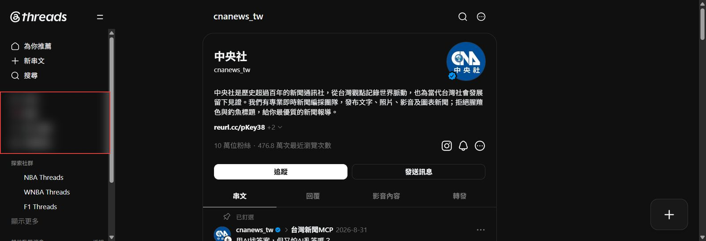</a></td>
<td width="50%"><b>捲動後</b> <a href="shots/threads_cnanews_tw_after_scroll.jpg">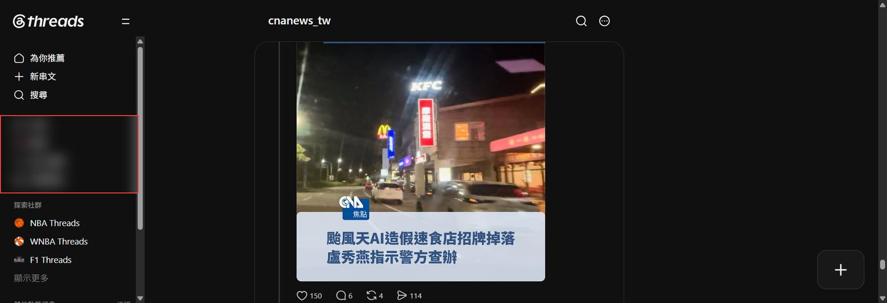</a></td>
</tr><tr>
<td width="50%"><b>F12 Network｜頂部</b> <a href="shots/threads_cnanews_tw_devtools_F12.jpg">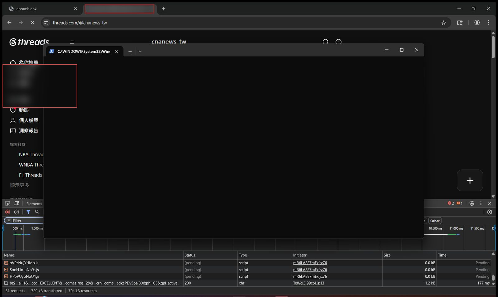</a></td>
<td width="50%"><b>F12 Network｜捲動後</b> <a href="shots/threads_cnanews_tw_devtools_F12_after_scroll.jpg">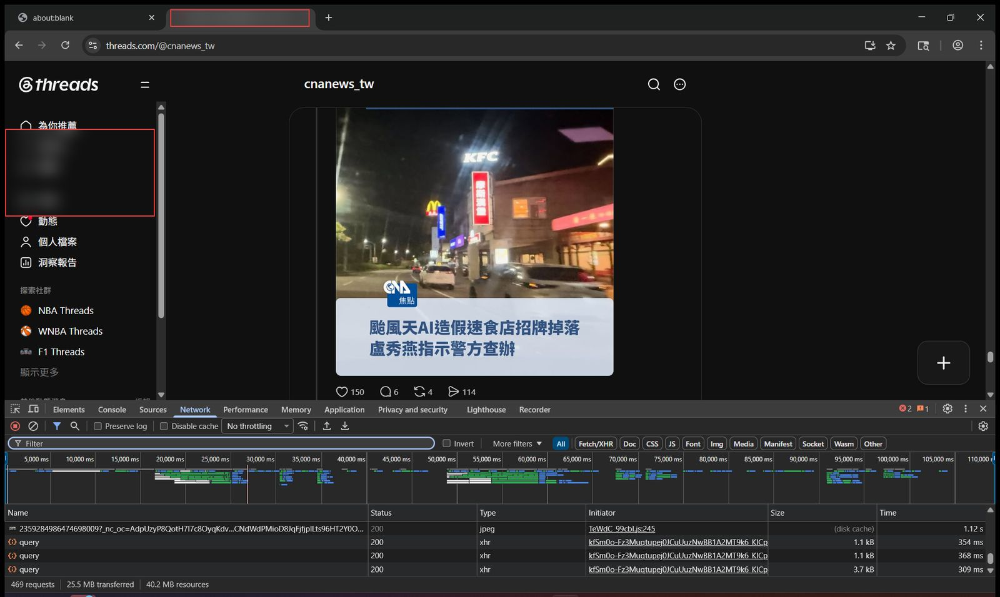</a></td>
</tr></table>

#### Threads · pts.news（HTTP 200 · 捲動 25 次 · API 回應 93 · 抓到 222 篇）

<table><tr>
<td width="50%"><b>頁面頂部</b> <a href="shots/threads_pts_news_top.jpg">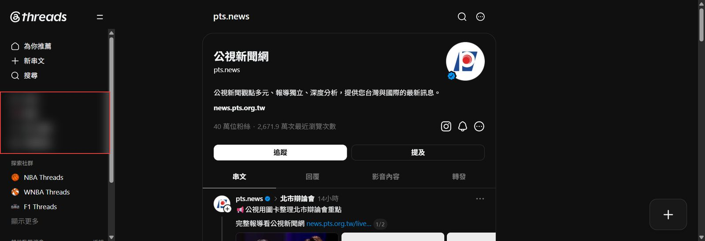</a></td>
<td width="50%"><b>捲動後</b> <a href="shots/threads_pts_news_after_scroll.jpg">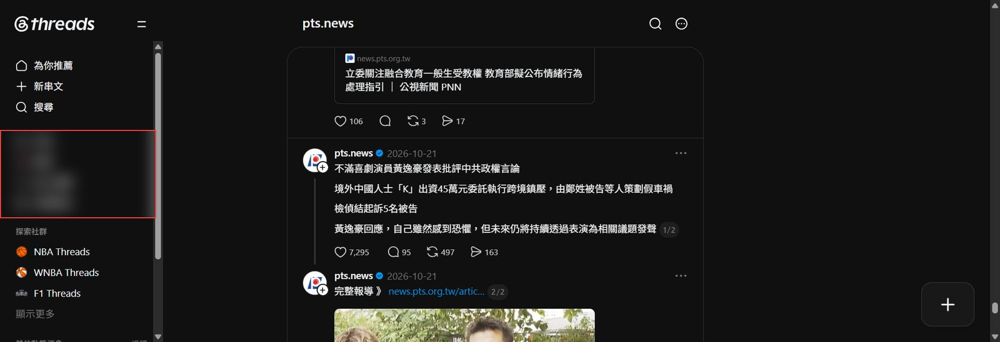</a></td>
</tr><tr>
<td width="50%"><b>F12 Network｜頂部</b> <a href="shots/threads_pts_news_devtools_F12.jpg">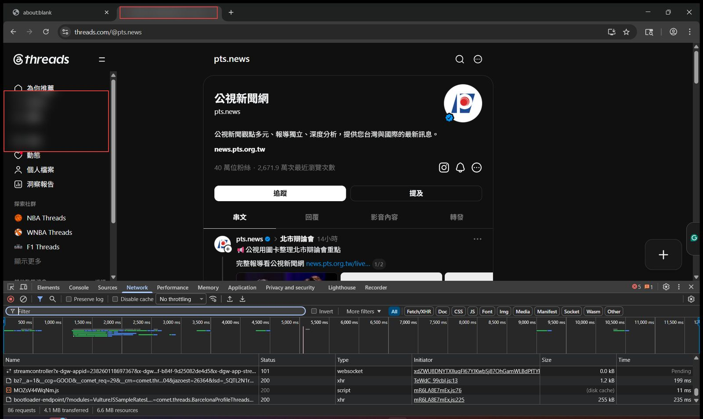</a></td>
<td width="50%"><b>F12 Network｜捲動後</b> <a href="shots/threads_pts_news_devtools_F12_after_scroll.jpg">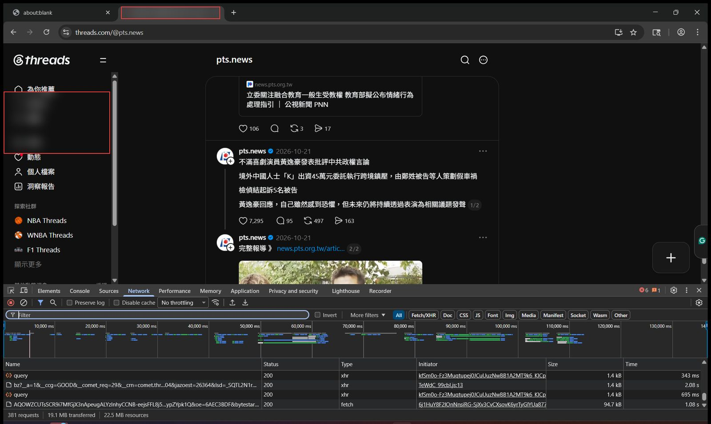</a></td>
</tr></table>

#### Threads · ftvnews（HTTP 200 · 捲動 25 次 · API 回應 111 · 抓到 189 篇）

<table><tr>
<td width="50%"><b>頁面頂部</b> <a href="shots/threads_ftvnews_top.jpg">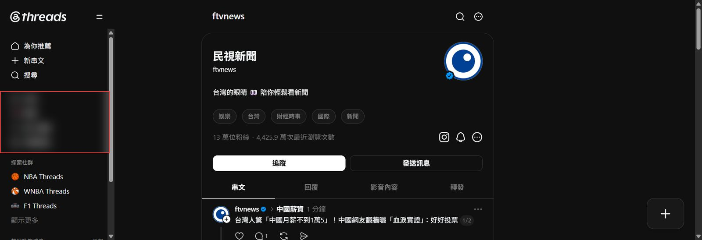</a></td>
<td width="50%"><b>捲動後</b> <a href="shots/threads_ftvnews_after_scroll.jpg">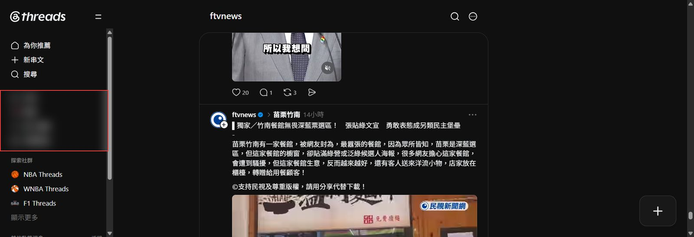</a></td>
</tr><tr>
<td width="50%"><b>F12 Network｜頂部</b> </td>
<td width="50%"><b>F12 Network｜捲動後</b> </td>
</tr></table>

## 沒有入庫的

- 未遮罩的原始截圖（有登入帳號的頭像）、遮罩後的請求帳本（8.6 MB JSON）、session 紀錄與三個平台的 jsonl 輸出，留在擷取機器上；本頁的數字都從那些檔案算出。
- 免登入那一側的原始截圖與欄位證據在各題的 `evidence/playwright/`，見 [`shared/docs/evidence.md`](../../../shared/docs/evidence.md)。
