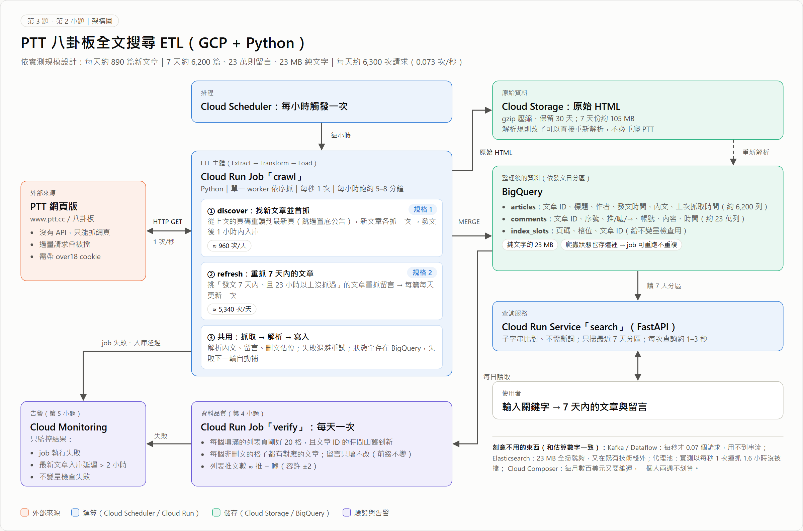
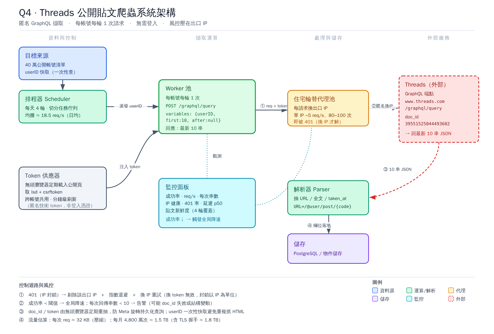
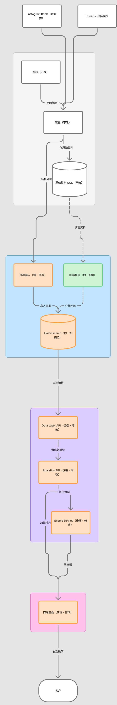
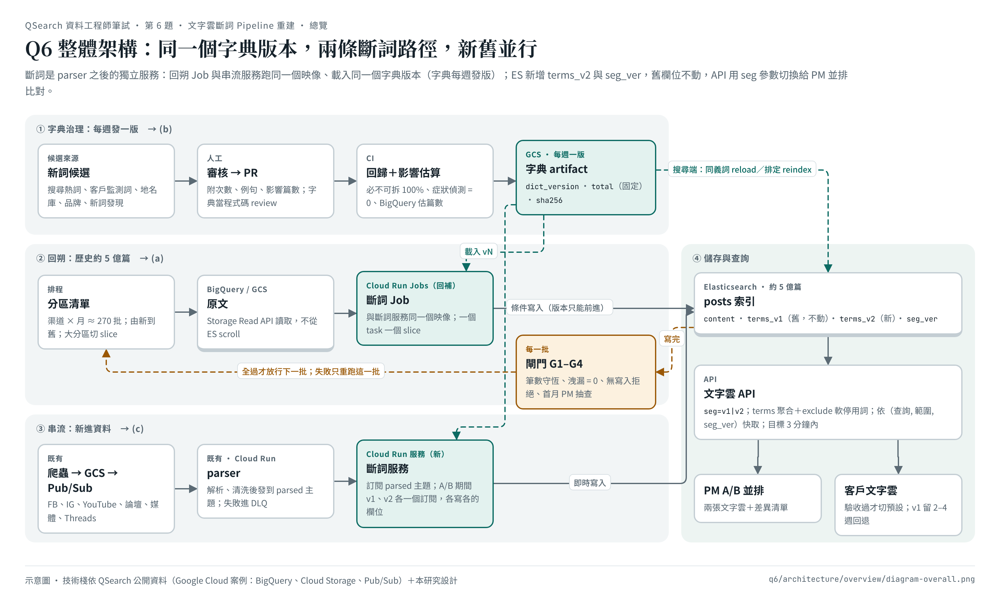

# QSearch 資料工程師筆試：Q1–Q6 交卷答案

字數算法：python `len`，空白與換行都算；Q2、Q3 的算式與 Q3 的架構圖依題目不計入字數。每題的程式、實測結果與截圖在 repo 的 `qN/` 資料夾，總架構見根目錄 README。

| 題 | 上限 | 本文字數 | 答案檔 |
|---|---|---|---|
| Q1 | 400 | 397 | [`q1/README.md`](../../q1/README.md) |
| Q2 | 600 | 585 | [`q2/answer/answer_600.txt`](../../q2/answer/answer_600.txt) |
| Q3 | 800 | 785 | [`q3/answer/answer_800.txt`](../../q3/answer/answer_800.txt) |
| Q4 | 600 | 600 | [`q4/answer/threads_q4_result.txt`](../../q4/answer/threads_q4_result.txt) |
| Q5 | 600 | 598 | [`q5/answer/answer_600.txt`](../../q5/answer/answer_600.txt) |
| Q6 | 600 | 599 | [`q6/answer/answer_600.txt`](../../q6/answer/answer_600.txt) |

## Q1

> [取捨] 顧客反饋整理
> 你被指派整理一批未經整理的顧客反饋資料，來自三個通路。三天後老闆要在董事會上用這份分析，主題是「今年最該優先修的三個產品問題」。你花了半天做完抽樣檢視，發現三個資料問題：
> 1. 客服信件（約 4 萬封）：純文字，沒有任何結構化欄位，且夾雜大量罐頭回覆、簽名檔、轉寄引文。
> 2. 問卷（約 2,000 份）：只有主動填答者，其中 8 成是購買滿 6 個月以上的老客戶。
> 3. 社群貼文（約 15 萬則）：含大量業配與同一批帳號的洗版內容。
> 你只有三天，評估後最多只能認真處理其中兩個問題。
> 請回答：
> 1. 你處理哪兩個、放棄哪一個？
> 2. 被放棄的那個會如何污染最終結論，你會在報告裡怎麼揭露？
> 3. 你的三天怎麼分配，會怎麼處理資料？
> 上限 400 字。

### 答案

1. **處理「客服信件」與「問卷」，放棄「社群貼文」。** 客服信件是顧客直接描述的問題，罐頭回覆與簽名可用模板聚類與規則移除；問卷雖只有主動填答者，但有結構化評分，可依購買期間分層。社群貼文的業配與洗版需要先標註帳號與文本，三天內難以可靠區分，而且不是本公司顧客的直接反饋。
2. **污染與揭露。** 結論會偏向已購買、會主動聯絡客服的老客戶，低估潛在客戶與公開抱怨的問題。報告第一頁列出覆蓋範圍與各數字的樣本來源；附「未涵蓋」一節說明社群沒有納入；抽樣 200 則社群貼文做人工定性檢視，只作佐證，不納入計數。
3. **三天分配。** 第一天：客服信件去罐頭回覆、簽名檔與轉寄引文（規則＋模板聚類），抽樣 300 則人工標註；問卷依購買期間分層、檢查偏誤。第二天：建立問題分類，計算各問題的提及數與佔比並排序。第三天：敏感度檢查（排除老客戶後排序是否改變）、撰寫董事會摘要與限制說明。

程式與佐證：[`q1/`](../../q1/README.md)

## Q2

> [估算與選型]
> 有 100 萬則 Facebook 粉絲頁貼文，平均 250 字中文，不含留言，另含心情互動統計、發文時間、粉絲頁名稱、粉絲頁 ID 等欄位。
> 這是一個內部工具：約 10 位同事使用，每天查詢量約 500 次，資料每日增量約 3,000 則。由你一個人維運，每月基礎設施預算 3,000 元。
> 1. 請估算：(a) 原始資料總量；(b) 粉絲頁 ID 索引；(c) 貼文中文全文索引。寫出算式與你假設的每一個參數，數量級對即可。
> 2. 承上，你選哪一套方案？請說明是估算結果的哪一個數字決定了你的選擇。
> 3. 你選的中文斷詞策略是什麼？它會漏掉哪一類查詢？
> 4. 資料量或查詢量成長到多少，你會換掉現在的選擇？換成什麼？
> 5. 題目中缺了哪一個數字，會讓你的估算差距最大？
> 上限 600 字（不含算式）。

### 答案

**1(a)** 約 1 GB：一則 918 B，一頁放 8 則，每則占 1,024 B，實測相同；真實中文 0.9 GB。

**1(b)** 約 7 MB：假設 5,000 個粉專，btree 去重，實測 6.9 MB。

**1(c)** 約 1 GB，與表同大：每則 249 個兩字詞。真實中文（PTT、維基，非粉專）實測 0.95 到 1.17 GB；重複造資料 0.41 GB 只是下限。

**2** 選 Cloud SQL PostgreSQL 加 pg_bigm。決定的是 (c) 約 1 GB：表加索引約 2 GB，小機器記憶體應放得下，每天 500 次查詢不需搜尋叢集。pg_bigm 比 pg_trgm 小 30%，非高頻 2 字詞快 3.7 到 4.9 倍。db-custom-1-3840 整套月費估約 NT$2,000；Cloud SQL 上未實測。

**3** 不用詞典，每兩字切一詞，LIKE 比對原文，新詞照查。會漏字面不同的查詢：異體字（台／臺）、同義詞、簡繁、錯字。

**4** 約 1 年後（215 萬則）資料超過記憶體，變慢就升規格（超預算）或只留近期資料；到約 1,000 萬則、尖峰每秒逾 1 次或需相關度排序時換 Elasticsearch（高頻詞全表掃描推估逾 6 秒）。

**5** 缺內文的不重複兩字詞數：它讓 (c) 差 0.76 GB，粉專數只讓 (b) 差 15 MB。

### 算式（不計入字數）

```text
【算式（不計入字數）】
【單位與幣別】
- 全篇 KB＝10^3 B、MB＝10^6 B、GB＝10^9 B（與 q2/code/RESULTS.md 相同）。原頁與根目錄 README 的 977 MB、388 MB、6.6 MB、21 MB、910 MB 是 MiB（1,048,576 B），換回 bytes 後與本文同一個數字。
- 「每月預算 3,000 元」假設為新台幣。匯率用 GCP README 隱含的值：NT$3,382 ÷ US$104.12 ＝ 32.48（Q2／Q3 規模那列 3,602 ÷ 110.91 也是 32.48）。

【1(a) 原始資料總量】題目給的參數：100 萬則、平均 250 字中文、不含留言。下面的欄位寬度是原頁的假設。
- 內文：250 字 × 3 B（UTF-8）＋ 4 B 長度標頭 ＝ 754 B
- 心情互動：7 種 × 4 B 整數 ＝ 28 B
- 發文時間：timestamp 8 B
- 粉專名稱：假設 20 字 × 3 B ＋ 1 B 長度 ＝ 61 B
- 粉專 ID：15 位數字存成 bigint，8 B
- 貼文 ID（題目沒給，自己補）：31 字元 ＋ 1 B ＝ 32 B
- 列標頭 24 B ＋ 對齊補 3 B ＝ 27 B
- 合計：754＋28＋8＋61＋8＋32＋27 ＝ 918 B，與原頁 pageinspect 讀到的 lp_len 918 B 相符；Linux／Windows 重跑 page0 是 920 B，仍是一頁 8 則。
- 一頁 8,192 B 只放得下 8 則，所以每則實際占 8,192 ÷ 8 ＝ 1,024 B
- 表 ＝ 1,024 B × 1,000,000 ＝ 1,024,000,000 B ≈ 1.0 GB。Linux PG16.15 實測 1,024,000,000 B／125,000 頁，與估算相同（本文的「實測相同」指表大小）。
- 真實中文（含標點與英數，一頁 9 則）實測：PTT 910,172,160 B、維基 902,643,712 B，約 0.9 GB。

【1(b) 粉專 ID 索引】btree 去重（原頁的「合併」算法：每個粉專 ID 只存一次，後面接各則的位址）。粉專數題目沒給，假設 5,000 個。
- 每則存一個 (頁, 格) 位址 6 B：6 B × 1,000,000 ＝ 6,000,000 B
- 每個粉專 ID 存 2 次，每次 20 B（索引標頭 8 ＋ key 8 ＋ 列指標 4），共 40 B：5,000 × 40 ＝ 200,000 B
- 除以 fillfactor 0.9：6,200,000 ÷ 0.9 ＝ 6,888,889 B ≈ 6.9 MB（原頁實測 6,889,472 B）
- 對照上限：若每則都是不同粉專、沒有去重，20 B × 1,000,000 ÷ 0.9 ＝ 22,222,222 B ≈ 22 MB
- 參考：Linux 重跑用 1 萬個粉專，量到 6,873,088 B

【1(c) 中文全文索引】兩字詞 GIN（pg_bigm）。本文「實測 0.95 到 1.17 GB」的兩端來源不同：0.95 GB 是真的 pg_bigm 在 PTT 重組語料上量的（已知重組少估約 8%）；1.17 GB 是維基用 GIN(array_ops) 模擬量的，維基沒有用真的 pg_bigm 量。
- 每則切出 250 − 1 ＝ 249 個兩字詞（真的 pg_bigm 在頭尾各補一個空白，是 251 個）
- 位址數：249 × 1,000,000 ＝ 249,000,000 筆
- 乘上每筆 bytes（由實測反推）：
  - 原頁的重複造資料（1,000 段內文各重複 1,000 次）每筆 1.63 B：249,000,000 × 1.63 ≈ 405,870,000 B ≈ 0.41 GB（Linux 重跑實測 406,257,664 B；原頁 406,396,928 B；真的 pg_bigm 409,567,232 B）。這只是下限。
  - PTT 100 萬則每筆 3.80 B：946,200,000 B（陣列模擬實測 946,946,048 B；真的 pg_bigm 953,729,024 B，多 0.72%）
  - 維基 100 萬則每筆 4.68 B：1,165,320,000 B（陣列模擬實測 1,165,492,224 B）
- 索引 ÷ 表：PTT 946,946,048 ÷ 910,172,160 ＝ 1.04；維基 1,165,492,224 ÷ 902,643,712 ＝ 1.29，所以說「與表同大」
- PTT 的 100 萬則是抽句重組的，量出重組少估約 8%（90,742,784 ÷ 99,033,088 ＝ 0.916），乘回去 × 1.09：946,946,048 × 1.09 ≈ 1.03 GB
- 每則索引體積會隨資料量下降，不能拿 5 萬或 10 萬則的結果線性外推

【2 選型】
- 表＋pg_bigm＋btree（PTT）：910,172,160 ＋ 953,729,024 ＋ 6,873,088 ＝ 1,870,774,272 B ≈ 1.9 GB（答案寫約 2 GB）
- db-custom-1-3840 是 1 vCPU、記憶體 3,840 MiB（官方 https://cloud.google.com/sql/docs/postgres/machine-series-overview ：名稱格式 db-custom-{CPUs}-{Memory}；頁面沒寫單位，這裡按 MiB 算）＝ 4,026,531,840 B ≈ 4.0 GB，是 1.9 GB 的 2.15 倍。「記憶體應放得下」是推估：作業系統與連線也要占記憶體，Cloud SQL 的快取設定沒有量。
- 查詢量：86,400 秒 ÷ 500 次 ＝ 平均 172.8 秒一次
- 體積：1 − 953,729,024 ÷ 1,371,783,168（pg_trgm，PTT）＝ 30.5%，pg_bigm 比 pg_trgm 小約 30%
- 2 字詞查詢中位數（pg_trgm ÷ pg_bigm，毫秒）：高雄 542.449 ÷ 146.553 ＝ 3.70 倍；颱風 539.734 ÷ 119.018 ＝ 4.53 倍；政府 659.365 ÷ 135.917 ＝ 4.85 倍，寫成 3.7 到 4.9 倍。pg_trgm 這三個詞都是全表掃描，pg_bigm 走索引。「台灣」出現在 54% 的列，pg_bigm 也走全表掃描，兩邊一樣（606／603 毫秒），所以本文寫「非高頻 2 字詞」。
- 成本：Terraform 預設 db-custom-2-7680 閒置總額 US$104.12 ≈ NT$3,382，是預算的 1.13 倍。改用 db-custom-1-3840（US$51.42）：
  - 單看這台：51.42 × 32.48 ≈ NT$1,670
  - 加上其他閒置資源（104.12 − 100.32 ＝ US$3.80）：55.22 × 32.48 ≈ NT$1,794
  - 以 Q2／Q3 規模計（110.91 − 100.32 ＋ 51.42 ＝ US$62.01）：62.01 × 32.48 ≈ NT$2,014，本文寫「整套月費估約 NT$2,000」
- 沒算進去的：README 的成本表以修改前 70 個資源計，第二輪新增的備份、PITR、Secret、Scheduler job 沒有計價；README 也沒有列磁碟，Terraform 沒設 disk_size。官方定價頁 https://cloud.google.com/sql/pricing 的預設區域 SSD 是 US$0.000232877／GiB-小時（約 US$0.17／GiB-月），asia-east1 的價格要在頁面下拉選單選，沒有取得。實際月費會比 NT$2,014 高。
- 量測環境：Docker 裡的 PostgreSQL 16.15 加 pg_bigm 1.2，4 核心、16 GB RAM 的容器，單機、無並發、3 次中位數。Cloud SQL 上沒有 CREATE EXTENSION，Terraform 沒有 apply；Terraform 目前是 POSTGRES_15，量測是 16.15，版本未對齊；sql_tier 預設仍是 db-custom-2-7680。

【4 換掉的門檻（推估，未壓測）】
- 第一段（記憶體）：每則表加索引 1,870,774,272 B ÷ 1,000,000 ≈ 1,870.77 B；4,026,531,840 ÷ 1,870.774272 ≈ 2,152,334 則（約 215 萬則）；(2,152,334 − 1,000,000) ÷ 3,000 ≈ 384 天 ≈ 1.05 年。用維基數字（902,643,712 ＋ 1,165,492,224 ＋ 6,873,088 ＝ 2,075.0 B／則）是約 194 萬則、313 天。這是用整台記憶體算的上限，實際能拿來快取的更少，會更早；但每則索引會隨量變小，又會晚一點，所以只寫「約 1 年」。
- 升規格：Terraform 預設的 db-custom-2-7680 閒置就是 NT$3,382，超過 NT$3,000，所以寫「超預算」；預算內的做法是只留近期資料。
- 第二段（換 Elasticsearch）：1,000 萬則是自訂的判斷門檻，不是由 repo 數字算出來的。到那時：
  - 要 (10,000,000 − 1,000,000) ÷ 3,000 ＝ 3,000 天 ≈ 8.2 年（每年新增 3,000 × 365 ＝ 1,095,000 則）
  - 表加索引：1,870,774,272 B × 10 ≈ 18.7 GB，是 db-custom-1-3840 記憶體的 4.6 倍（線性外推是上限，因為每則索引會隨量變小）
  - 高頻詞全表掃描：0.606 秒 × 10 ≈ 6.1 秒。0.606 秒是 4 核心、16 GB 容器量的（資料全在快取、單一程序、計畫沒有平行 worker 是當時的執行條件，JSON 未記錄）；1 vCPU、資料放不進記憶體時只會更慢，所以寫「推估逾 6 秒」，是下限的推估，不是實測。
- 查詢量門檻：最壞情況一次 0.606 秒，一個程序每秒約 1 ÷ 0.606 ≈ 1.65 次，所以抓尖峰每秒超過 1 次。這個 0.606 秒同樣是 4 核心容器、無並發的單次時間，1 vCPU 上沒有量。

【5 缺的數字】
- 「內文的不重複兩字詞數」指全部內文切出的不重複兩字詞（GIN entry 數），代表內文重複程度。同樣 100 萬則、每則 250 字：重複造資料 248,926 個 → 索引 406,257,664 B；PTT 848,556 個 → 946,946,048 B；維基 4,716,600 個 → 1,165,492,224 B。這是三組資料的對照，不是公式。
- (c) 的差距：1,165,492,224 − 406,257,664 ＝ 759,234,560 B ≈ 0.76 GB
- (b) 的差距（粉專數）：22,222,222 − 6,888,889 ＝ 15,333,333 B ≈ 15 MB
- 用絕對值比，不用倍數：同為 100 萬則時 (c) 只差 1,165,492,224 ÷ 406,257,664 ＝ 2.87 倍，比 (b) 的 22,222,222 ÷ 6,888,889 ＝ 3.23 倍還小，但 (c) 差的是 GB、(b) 差的是 MB，0.76 GB 是 15 MB 的約 50 倍。只看真實中文（PTT 真的 pg_bigm 953,729,024 B 到維基 1,165,492,224 B）也差 211,763,200 B ≈ 0.21 GB，仍大於 15 MB。
- 參考上限：隨機不重複字每則 9,466 B，但那是 Windows 上 10 萬則的值，100 萬則會較低，不能外推，也不是粉專貼文會出現的情況，所以不放進本文。
```

程式與佐證：[`q2/`](../../q2/README.md)

## Q3

> [設計] PTT 全文搜尋系統
> 我們要做一個 PTT 八卦板全文搜尋系統：使用者輸入關鍵字，查找過去 7 天內所有包含該關鍵字的貼文，以及文章下的留言。請設計滿足此需求的 ETL Pipeline。
> 資料規格：
> - 文章即時性：新文章需在發布後 6 小時內納入搜尋範圍。
> - 留言新鮮度：包含關鍵字的文章，其留言在 7 天內每天至少更新一次。
> 工程約束：
> - 你一個人維運，兩週內上線。
> - 公司既有技術棧：GCP + Python。導入棧外的東西需要額外說明理由。
> - PTT 是別人的網站，你沒有 API，且過度請求會被擋。
> 請回答：
> 1. 先估規模（文章數／留言數／文字量／每日抓取請求數），再開始設計。你的架構必須和你的估算數字一致。
> 2. 架構圖 + 每個環節的 infra 選擇與理由。不需寫程式碼，pseudo code 可。
> 3. 上述兩條資料規格，哪一條主導了你的成本？ 兩者相差多少倍？
> 4. 你如何驗證抓取的資料沒有遺漏？請給出一個可自動檢查的不變量（invariant），而不只是「比對筆數」。
> 5. 你決定不監控哪三件事？各自的風險為何可以接受？
> 6. 若你認為某項規格不合理或定義不清，可以提出修改，但必須說明代價。
> 另：交卷時可附一個（只能一個）動工前想問的問題。
> 上限 800 字（不含架構圖與算式）。

### 答案

**1.** POC 實爬 10/26–27：每天約 890 篇，7 天 6,237 篇、留言 234,577 則、純文字 22.9 MB。每日請求＝首抓 890＋列表 70＋重抓 890×6＝6,300 次，尖峰小時約 450 次，單程序即可。

**2.** 見附圖。Cloud Scheduler 每小時啟動 Cloud Run Job：單 worker 每秒最多 1 次，抓新文並重抓 7 天內逾 23 小時未抓者。原始 HTML 存 GCS 備重解析；結果 MERGE 進 BigQuery 依發文日分區，失敗下輪補；查詢 API 用 Cloud Run。選 BigQuery 不選 pg_bigm：純文字才 23 MB，全掃免建索引，無資料庫主機要顧；代價是延遲未實測（圖上 1–3 秒為預估）。全用 GCP＋Python；POC 約每 1.1 秒一篇、連抓 1.62 小時未被擋，先不用代理池。

**3.** 規格 2 主導：每天 5,340 次對 960 次，約 5.6 倍。

**4.** 每日檢查：7 天內每個填滿的列表頁恰 20 格，每格是刪文佔位或 BigQuery 有其文章 ID，且相鄰 ID 時間戳不倒序。POC：334/334 頁 20 格、6,259 對 0 倒序。

**5.** (1) 單次請求失敗與延遲：普查 0 篇失敗，下輪會補，只告警結果。(2) 事後刪文 404：13 篇（0.2%，下限），重抓時標記。(3)「檔案過大」截斷留言：6,224 篇中 2 篇，網頁版就拿不到。

**6.** 「含關鍵字」抓取時無從得知，只能全抓；第 2–6 天重抓每天 4,450 次只多 0.76% 留言。建議改為發文滿 24 小時再抓一次，每日降到約 1,850 次，代價是 9.7% 文章少了這 0.76% 留言。

問題：關鍵字要比對留言嗎？留言佔純文字 71%，文字量差 3.5 倍。

### 算式（不計入字數）

```text
【算式（不計入字數）】
單位：MB＝10^6 B、kB＝10^3 B（與 result_B.txt、make_charts.py 的 /1e6 一致），全篇只用這一種。result_B.txt:21 的「16.4 KB」是 make_charts.py:173 用 /1024 算的，下面已換算成 10^3 B。
資料性質：10/26 實爬 7 天列表＋10/27 打開 7 天全部文章的普查，都是一次性的 POC 量測，不是系統上線後的監測值。10/30 那輪驗證沒有重新抓 PTT，只做了離線重算（RESULTS.md:5）。

[1 規模]
每日新文 N＝6 個完整日（10/20–10/25）合計 ÷ 6＝(902＋894＋1,109＋886＋805＋744) ÷ 6＝5,340 ÷ 6＝890 篇/天（範圍 744–1,109）
7 天文章＝列表實數 6,237 篇（普查結果：200＝6,224、404＝13）
7 天留言＝234,577 則（普查全數，每篇平均 37.7）
純文字＝內文 6,224 × 1,054 B ≈ 6.56 MB ＋ 留言 234,577 × 69.7 B ≈ 16.35 MB ＝ 22.9 MB（result_B 先用原始 bytes 加總、最後才四捨五入；69.7 B＝推/噓/→ 3.0＋帳號 7.8＋時間 25.2＋內容 33.7）
規格 1（每日）＝首抓 N ＋ 列表頁 70 ＝ 890 ＋ 70 ＝ 960 次
  假設參數：列表頁 70 次/天是 repo 裡的設定值（make_charts.py:200、ptt_q3_recheck.py:207）。repo 只寫了數字，沒寫推導，也沒寫這是 6 小時排程還是每小時排程的量（見 [3]）。
規格 2（每日）＝每篇在發文第 1–6 天各重抓一次 ＝ N × 6 ＝ 890 × 6 ＝ 5,340 次（第 0 天的首抓算在規格 1）
每日合計＝960 ＋ 5,340 ＝ 6,300 次；6,300 ÷ 86,400 秒 ＝ 0.0729 ≈ 0.073 次/秒
尖峰小時＝尖峰每小時 64 篇 × 7 批（首抓＋6 次重抓）＝ 448 ≈ 450 次
  每秒 1 次（設計上限）：448 秒 ≈ 7.5 分鐘
  POC 普查平均每 1.11 秒一篇：448 × 1.11 ≈ 497 秒 ≈ 8.3 分鐘
  程式現在的預設間隔 1.5 秒（推估約每 1.8 秒一次＝1.5＋平均回應 0.295 秒，未實測）：448 × 1.8 ≈ 806 秒 ≈ 13.4 分鐘
  三種都遠小於 60 分鐘，也小於 Terraform 設的 Job timeout 3,000 秒（run.tf:162）

[2 架構]
排程：Terraform ptt-crawl-hourly，cron "5 * * * *"（每小時第 5 分）；ptt-crawl Job 設 task_count 1、parallelism 1（單一 worker）
GCS 原始 HTML：7 天 104.5 MB（普查）；每篇平均 104.5 × 10^6 ÷ 6,224 ≈ 16,790 B ≈ 16.8 kB
BigQuery：7 天純文字總量 22.9 MB（答案取整寫 23 MB）只是掃描量的上限。BigQuery 是欄式儲存，查詢只掃用到的欄位；例如只比對內文和留言內容欄，約 6.56 ＋ 7.91 ≈ 14.5 MB
選型差別：pg_bigm 也不用斷詞（二字詞索引，README.md:642 實測 2 字詞走索引 119–147 毫秒），但要建 GIN 索引、要 CREATE EXTENSION（README.md:86 註明還要在真實 project 驗證），也要一台 Cloud SQL 主機。BigQuery 全掃，不用建索引，也沒有主機。代價是 BigQuery 的查詢延遲沒有實測；架構圖寫的「每次查詢約 1–3 秒」（architecture.html:129）在 repo 裡找不到量測紀錄，所以答案標為預估
POC 抓取速度：普查平均每 1.11 秒一篇 ≈ 0.90 篇/秒（每次停 0.8 秒＋平均回應 0.295 秒，q3/data/ptt_q3_census_out/result_B.txt），低於設計上限每秒 1 次。普查分 2 段跑，中途中斷的原因沒有記錄；最長連續 1.62 小時；最後狀態失敗 0 篇。「未被擋」只代表最後 0 篇失敗
出口 IP：Terraform 沒有 apply（shared/infra/gcp/README.md:9），正式設計走 Cloud NAT 固定 IP（run.tf:165），這個 IP 沒測過。所以答案寫「先不用代理池」，上線第一週觀察 403／429 再決定

[3 倍數]
5,340 ÷ 960 ＝ 5.5625 ≈ 5.6 倍
依每天發文量計的範圍：6 × 744 ÷ (744 ＋ 70) ＝ 5.48；6 × 1,109 ÷ (1,109 ＋ 70) ＝ 5.64
列表 70 次的口徑：chart-spec-cost（make_charts.py:207）寫「把 6 小時收緊到 1 小時只多約 20 次列表請求（+2%）」。如果 960 是每小時排程的成本，只為滿足 6 小時規格的規格 1 約 940 次，倍數是 5,340 ÷ 940 ≈ 5.68；如果 960 是 6 小時的口徑，倍數是 5.56。兩種都落在 5.6–5.7，所以答案寫「約 5.6 倍」
（舊算法把首抓也算進規格 2：894.6 × 7 ≈ 6,262 次對 947 次 ＝ 6.6 倍，不採用）

[4 不變量]
列表檔共 335 頁、6,685 列＝填滿頁 334 頁 × 20 格 ＋ 最新頁 5 列（2026-10-30_recheck.json:7–11）
這 334 頁是 index38879–39212，含視窗起點前 1 頁（index38879）。視窗內填滿的是 333 頁（38880–39212），39213 是只有 5 列的最新頁
334/334 頁剛好 20 格；有 ID 的列＝6,685 − 刪文 425 列 ＝ 6,260 列 → 相鄰 6,259 對，倒序 0 對（範圍是全部 335 頁，不只視窗內的 6,237 篇）
輔助檢查：列表推文數＝推−噓，3,797 篇中 97.2% 完全相同，99.6% 差距在 ±2 以內

[5 不監控]
刪文 404：13 ÷ 6,237 ＝ 0.21% ≈ 0.2%
  這只量到「10/26 列表快照時還在、10/27 普查時已 404」的文章，大約只涵蓋 1 天。列表上另有約 422 篇（6.3%）刪文佔位，刪除時間不明。正式設計在 1 小時內首抓、文章要持有 7 天，首抓之後才被刪的比例沒有量到，所以 0.2% 只是下限。可以接受的理由：每天重抓時會標記，最多晚約 24 小時下架
截斷：2 ÷ 6,224 篇
普查失敗 0 篇。約 10 篇推測是第一次失敗、退避 5 秒後重試成功，所以實際請求數至少 6,237 次、約 6,247 次（6,247 不是硬上限）

[6 規格修改]
第 2–6 天的重抓＝890 × 5 ＝ 4,450 次/天
修改後每日請求＝規格 1 960 ＋ 第 1 天重抓 890 ＝ 1,850 次（6,300 ÷ 1,850 ≈ 3.4 倍）
「發文滿 24 小時」：圖表把第 1 次重抓的區間定為發文後 (1 小時, 24 小時]（make_charts.py:248），99.22% 是發文滿 24 小時時的累積比例；如果更早重抓，漏掉的會比 0.76% 多
邊際效益（以 1,414 篇發文已滿 7 天的文章、54,006 則留言計，只有一週的 POC）：首抓 63.8% ＋ 第 1 次重抓 35.4% ≈ 99.22%；第 2–6 次合計 0.45 ＋ 0.11 ＋ 0.11 ＋ 0.05 ＋ 0.03 ≈ 0.76%（各長條四捨五入後加總是 0.75，以圖表標的 0.76% 為準）；168 小時內累積 99.98%，剩下約 0.02% 在 168 小時之後才進來
受影響文章：24 小時後仍有新留言的文章 505 ÷ 5,182 ＝ 9.7%。這是發文已滿 3 天的子集，和 0.76% 的母體（滿 7 天、1,414 篇）不同，兩者是同一份普查的兩個子集

[問題]
22.9 ÷ 6.6 ＝ 3.47 ≈ 3.5 倍，指的是要索引的文字量（q3/README.md:86、make_charts.py:197）；留言佔純文字 71.4%（以 bytes 計）
3.5 倍含留言的推噓、帳號、時間欄位（result_B.txt:19、22）。如果 BigQuery 只比對留言內容欄：(6.56 ＋ 234,577 × 33.7 B ÷ 10^6) ÷ 6.56 ＝ (6.56 ＋ 7.91) ÷ 6.56 ≈ 2.2 倍；連帳號一起比對：(6.56 ＋ 234,577 × 41.5 B ÷ 10^6) ÷ 6.56 ≈ 2.5 倍。所以答案寫「文字量」，不寫「掃描量」
```



程式與佐證：[`q3/`](../../q3/README.md)

## Q4

> [設計] Threads 爬蟲系統
> 我們需要建置一套 Threads 貼文爬蟲系統，目標涵蓋 40 萬個帳號，擷取欄位須包含貼文 URL、內文與發文時間。該頁面為公開頁面，無需登入即可存取。每個帳號每次至少擷取 10 篇貼文，每日執行 4 輪抓取。
> (a) 根據你的評估，此系統每日需發送多少次 HTTP requests？請說明估算邏輯。以及對於 Threads 網站上頭實質的 requests 呼叫狀況掌握多少？
> (b) 若使用單一 IP 發送請求，將面臨反爬蟲機制的封鎖風險。此外，由於大量開發者已在主流雲端平台上部署類似服務，其對外 IP 段多半已遭 Threads 列入黑名單。請問你會採用什麼策略突破封鎖？如何選擇代理（Proxy）方案？
> (c) 請估算上述方案每月的代理成本，並檢附計算方式，與牌價。
> 上限 600 字。

### 答案

(a) 請求量：未登入時 profile HTML 只內嵌 4 串，但網頁的分頁 GraphQL query 帶 userID、after=null、first=10 即回最新 10 串，含 code（組 URL）、全文、taken_at，不必抓 HTML。每帳號每輪 1 次：40 萬×4＝每日 160 萬次（約 18.5 req/s）。userID 快取一次；csrftoken/lsd 由無頭瀏覽器定期取得、跨帳號共用，免登入與 cookie。

(b) 防封：須帶瀏覽器 Sec-Fetch 標頭與 4 個 x-header，缺一即取不到貼文。實測單一 IP 以 5 req/s 打約 80–100 次，GraphQL 即按 IP 封鎖（401，換 token 無效，5 分鐘未解；HTML 不受影響）。故採住宅輪替代理、每請求換 IP；遇 401 剔除該 IP、退避，監控成功率與每次串數，異常即降速。另 robots.txt 禁止未經書面許可自動蒐集。

(c) 成本：實測每次回應 27.8 KB、上傳 4.1 KB，每月 4,800 萬次約 1.5 TB，含 TLS 約 1.8 TB。IPRoyal 住宅 $1.84/GB 約 US$2.8–3.3k/月；Oxylabs $2.5/GB 約 US$3.8–4.5k/月。ISP 固定 IP 因單 IP 可持續速率未知且封鎖久，不作主力。



程式與佐證：[`q4/`](../../q4/README.md)

## Q5

> [Planning 能力] 新指標上線的全鏈路時間估算
> 客戶提出需求：希望在平台上看到 Instagram Reels 的觀看數（video_view_count）和 Threads 貼文的轉發數（repost_count）。
> 經過調查發現：
> - 爬蟲端其實「已經有爬到這些欄位」，只是從未寫入 Elasticsearch
> - 需要在以下層級全部新增支援：爬蟲寫入 → ES mapping 更新 → Data Layer API 新增欄位 → Backend Analytics API 回傳 → Export Service 匯出 → 前端顯示
> - 產品端期望：指標延遲時間不超過 1 小時（即文章發佈 1 小時後，數據應可被查詢）
> - 歷史資料方面：Instagram video_view_count 的資料起始日為 2026/5/1，Threads 的轉發數和分享數過去已有爬取但未寫入 ES
> (a) 請畫出（或文字描述）這個需求從「爬蟲已有原始資料」到「使用者在前端看到數據」的完整資料流圖。標示出每一個需要修改的元件。
> (b) 請逐層估算每個環節的開發工時。如果團隊有 1 位資料工程師 + 1 位後端工程師 + 1 位前端工程師可以平行作業，你估計從開工到上線的 calendar days 是多少？關鍵路徑在哪裡？
> (c) 關於「Threads 轉發數與分享數其實過去已有爬取但未寫入 ES」這件事——你會怎麼設計回補（backfill）流程？需要考慮哪些風險（例如歷史資料的欄位名稱可能不一致、原始資料可能有缺漏、backfill 期間的寫入負載對線上查詢的影響）？
> (d) 「指標延遲不超過 1 小時」這個 SLA，你認為瓶頸最可能出現在哪個環節？你會怎麼監控這個 SLA 是否達標？
> 上限 600 字。

### 答案

**(a)** 見 architecture/ 資料流圖：題目六層（爬蟲寫入到前端顯示）都要改，另加回補 Job 與 SLA 監控。

**(b)** 工時（小時）：mapping 6、爬蟲寫入 12、回補 16、Data Layer 8、Analytics 10、Export 6、前端 10、整合監控 8、驗收 4。關鍵路徑是 DE 一人依序做 mapping、爬蟲、回補、整合，再接全員驗收，共 46 小時；BE、FE 先定 API 契約再平行，浮時至少 16 小時。46÷8＝5.75 天，加 30% 審查取 8 天，加 1 天緩衝共 9 工作天，週一開工約 11 個日曆天。

**(c)** 先盤點 GCS 各期 key 建別名表。依平台×週切批；同篇多次抓取，每欄取有值的最新一次，缺 key 不算、null 不補 0。對線上 index 做 bulk 部分更新，每欄附抓取時間，腳本只在較新時寫入，舊值蓋不掉新值，重跑全是 noop；爬蟲寫入也附同一時間戳。壞行超過 1%、整檔壞掉、任一分區某欄讀不到超過 20%（多半是改名）就停。限速、離峰、不改 refresh，只重送被拒的筆。

**(d)** 瓶頸在爬蟲抓取頻率：輪詢間隔 60 分鐘時最壞會超標，寫入只要秒到分鐘。監控首次可見延遲 P95（超過 45 分鐘警告）、1 小時內抓到的比例、Pub/Sub 積壓、refresh 設定，並用金絲雀帳號每小時驗證。



程式與佐證：[`q5/`](../../q5/README.md)

## Q6

> [Planning 能力] 文字雲斷詞 Pipeline 重建
> 你加入一間社群輿情分析 SaaS 公司，主力產品是讓企業客戶輸入關鍵字後，即時查詢跨社群平台（Facebook、Instagram、YouTube、論壇、媒體、Threads）的聲量趨勢與文字雲。
> 目前的文字雲功能使用一份維護多年的繁體中文字典檔進行斷詞，但產出品質有嚴重問題：短網址後綴出現在結果中、電話號碼被當成詞彙、中文助詞（的、了、在）未被過濾、地名變體被拆散（例如「高雄市」被拆成「高」「雄」「市」）、搜尋高頻詞反而沒出現在文字雲中。
> 團隊決定重寫斷詞演算法，你被指派負責整個 Data Pipeline 的設計。以下是已知條件：
> - 需處理 6 個渠道、覆蓋 2023 年 1 月至今的所有歷史資料
> - 目前 Elasticsearch 中儲存的社群貼文總量約 5 億筆
> - 新舊斷詞結果需並行提供，讓 PM 可 A/B 比對驗收
> - 產品端的查詢回應時間目標：單次文字雲查詢不超過 3 分鐘（初期可放寬，但正式上線須達標）
> - 新資料需透過 Streaming Pipeline 即時斷詞寫入
> (a) 請設計這個「歷史資料回朔斷詞」的執行策略。你會怎麼拆分批次？以什麼為單位排程（年份？渠道？還是其他維度）？每個批次之間需要什麼樣的品質檢查點？請具體估算：如果團隊只有 1 位資料工程師負責，從 POC 驗證到 6 渠道全部完成上線，你估計需要多少個工作天？請列出你的假設。
> (b) 字典檔品質直接影響斷詞結果。請問你會怎麼設計字典檔的維護流程？如何處理「斷詞用字典」和「搜尋用字典」是否共用的問題？如果走不同字典檔，對系統架構有什麼影響？（提示：原團隊估計走不同字典檔需額外 20+ 工作天，走相同字典檔約 10 天）
> (c) Streaming Pipeline 上線後，如何確保新進資料的斷詞結果與歷史回朔資料的品質一致？如果字典檔日後更新了一個新詞，是否需要重新跑全部歷史資料？你會怎麼設計讓這件事可控？
> 上限 600 字。
>
> *若有撰寫的程式碼，請一併隨信附上

### 答案

**(a)** 以「渠道×月」為一批，約 270 批、平均 185 萬篇：渠道定清洗規則、月份控批量，失敗只重跑一批；由新到舊。新結果寫 terms_v2，舊欄位不動，API 以 seg 參數供 PM 並排比對；文字雲以 ES terms 聚合數篇數。每批過閘門：筆數守恆；網址、電話、停用詞洩漏為 0；金標詞召回不低於上版；ES 無寫入拒絕、p95 不惡化；PM 抽查。估 45 工作天：基準 2、POC 5、字典整併 10、工程化 6、回朔與驗收 12、壓測切換 3、緩衝 7。jieba 約 150 核心小時；ES 限速每秒 3,000 篇、離峰約 6 晚。

**(b)** 字典當程式碼管：熱詞、監測詞、地名庫與新詞發現進候選，審核後發 PR，CI 跑回歸並估影響篇數，週發版。共用核心詞庫，搜尋與文字雲各加用途層（同義詞／停用詞、變體合併）：搜尋細切、文字雲精確切。分開則多出同步、對帳與兩套回歸，點文字雲的詞未必搜到同一批文，即多出的 20 天。

**(c)** 批次與串流用同一映像，每篇記 seg_ver（只能前進）與字典、停用詞、程式的雜湊指紋，原文另記 content_sha；每天抽樣重算須零差異。字典更新不全量重跑：停用詞查詢時處理；新詞用 ES 字元片語查出含該字串的文章重跑。jieba 固定 total，不含新詞的文章才不變（未固定時 20 萬篇有 52 篇變）。換演算法才開新欄位全量重跑。



程式與佐證：[`q6/`](../../q6/README.md)
